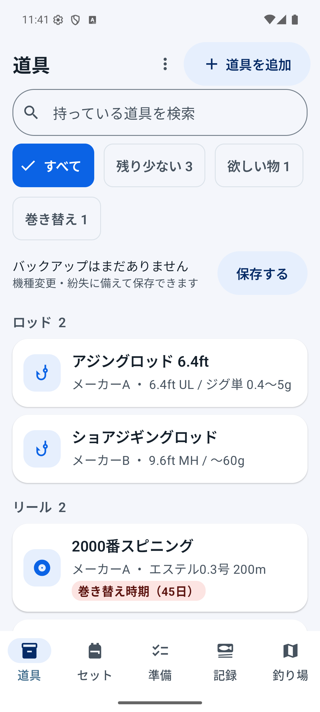
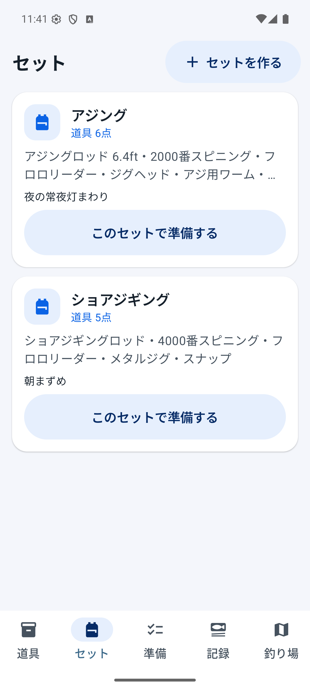
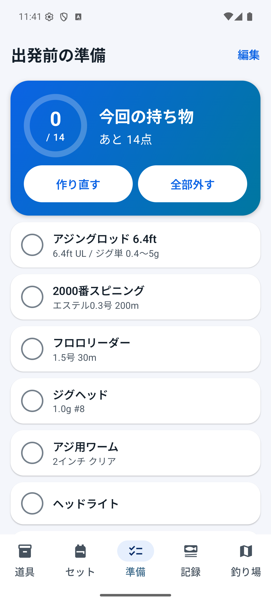
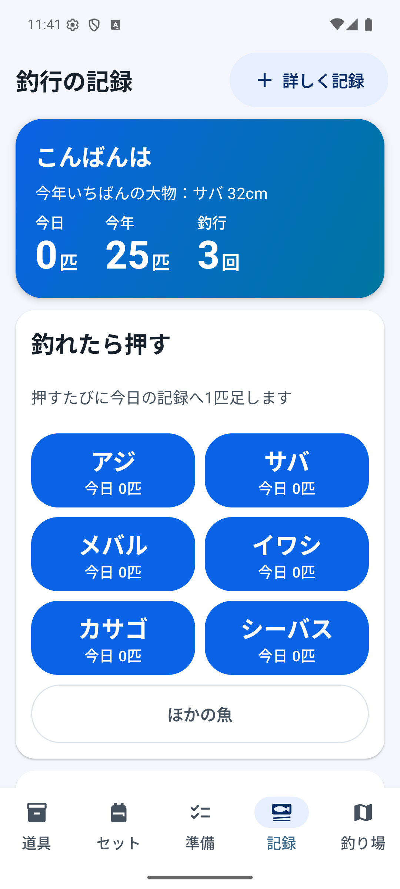
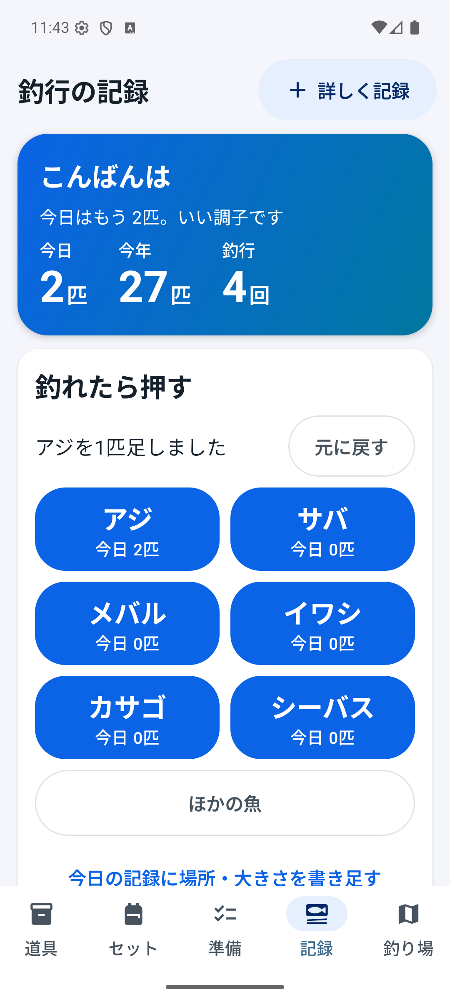
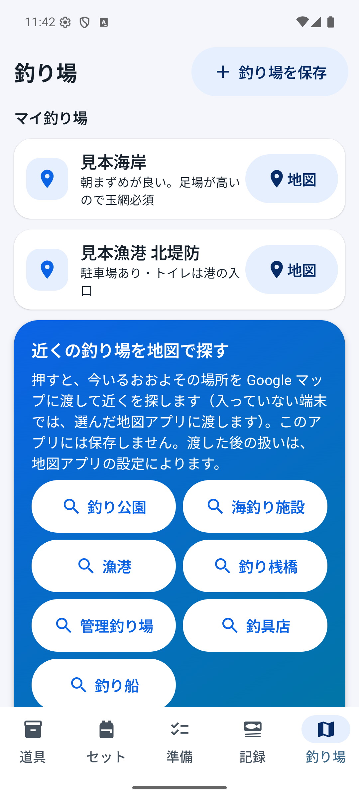
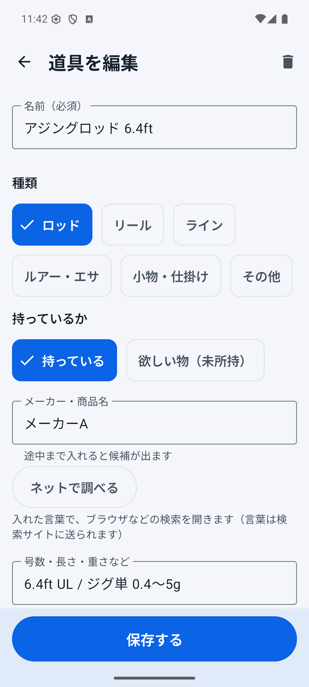
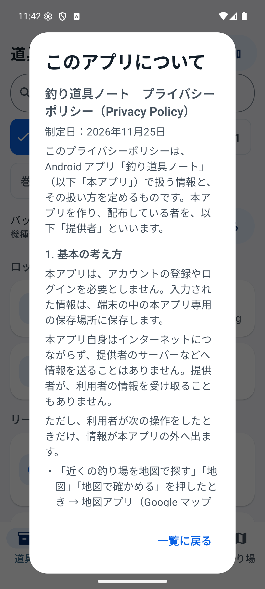
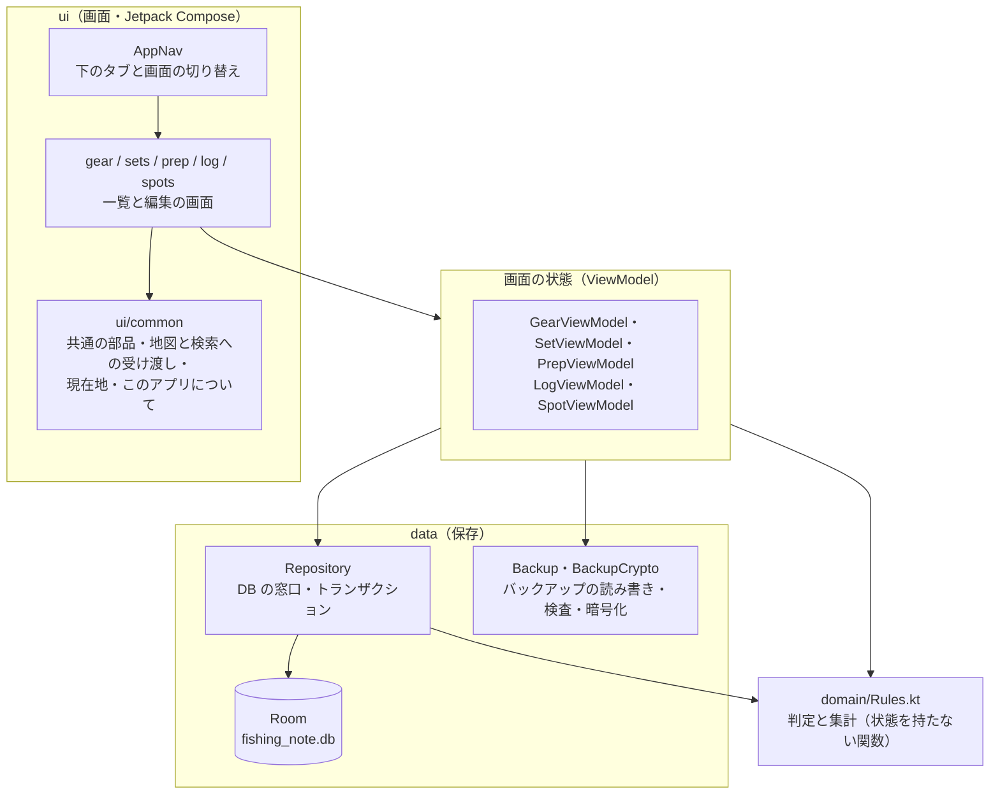
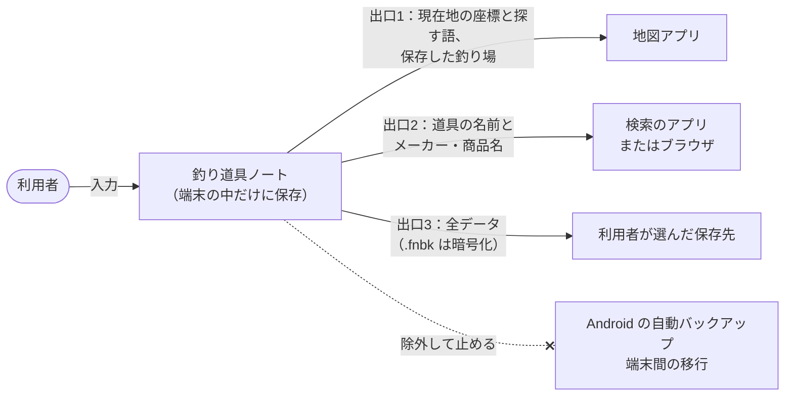

<!--
ファイル名: README.md
バージョン: 0.9.1
作成日: 2026-11-24
変更履歴:
  - 0.5.0 (2026-11-24) 新規作成（ビルド・テスト・見本データの入れ方）
  - 0.5.1 (2026-11-24) 端末上のテストに署名の確認を追記
  - 0.6.0 (2026-11-24) バックアップの暗号化を追記
  - 0.6.1 (2026-11-25) パスワードの決まりとパスワードを作る機能を追記
  - 0.6.2 (2026-11-25) パスワードの強さの見積もりと、使っている外部ライブラリを追記
  - 0.7.0 (2026-11-25) メーカー・商品名の候補と「ネットで調べる」を追記
  - 0.7.1 (2026-11-25) ライセンスの表示を追記
  - 0.7.2 (2026-11-25) 元の zxcvbn のライセンスを追記
  - 0.7.3 (2026-11-25) プライバシーポリシーの表示を追記
  - 0.7.4 (2026-11-25) 単体テストが原稿の変更でやり直されるようにした。未記入の欄の例を直した
  - 0.8.0 (2026-11-25) ポートフォリオの形に書き直し（概要・画面・構成と処理の流れの図・設計書の一覧・設計上の判断・CI）
  - 0.9.0 (2026-11-26) 入力した文字を端末の自動入力・キーボード・ユーザー補助のサービスが受け取りうることを追記。第三者の監査・法律の専門家の確認を受けていないことと、プライバシーポリシーが配布前の下書きであることを追記
  - 0.9.1 (2026-11-26) 確認を受けていない範囲から、リポジトリに置かない下書きを外した
-->
# 釣り道具ノート（Android / Kotlin・Jetpack Compose）

[](https://github.com/takato-y/FishingNote/actions/workflows/build.yml)

- GitHub Actions で検査している範囲：単体テスト、テスト仕様書の一覧が最新であること、設計書と障害対応手順書のエラーIDと機能IDの突き合わせ、デバッグ版 APK の作成
- 手元の環境でのみ確認した範囲：端末上のテスト（エミュレータ Pixel 8・API 36）、画面の見た目と操作（[テスト仕様書](docs/04_テスト仕様書.md) の「画面で確かめたこと」）

**釣りをする人のための、道具の管理・出発前の持ち物チェック・釣果の記録・釣り場探しを1つにまとめた Android アプリです。**

ログインはなく、データは端末の中だけに保存します。アプリ自身はインターネットの権限を持ちません。

本リポジトリはポートフォリオ（閲覧用）です。無断での再利用・再配布はご遠慮ください。

## 概要

| これまで | このアプリを使った後 |
|---|---|
| 釣具店で、持っている道具を思い出せずに同じ物を買う | 持っている道具をその場で検索できる。欲しい物・残りが少ない消耗品も一覧で分かる |
| ラインを巻き替えた日を忘れる | 巻き替えてからの日数を表示し、決めた日数を過ぎたら「巻き替え時期」と目立たせる |
| 釣りの種類ごとに道具をそろえるたびに、忘れ物をする | 道具の組み合わせ（タックルセット）といつもの持ち物から、チェックリストを作る |
| 釣りの最中は記録を付ける余裕がない | 魚のボタンを1回押すだけで、今日の記録に1匹足す |
| ログインが要るサービスは、アカウントを失うとデータも失う | ログインなし。ファイルへのバックアップ（パスワードで暗号化できる）で機種変更に備える |

## 画面

| 道具 | セット | 出発前の準備 | 釣行の記録 |
|---|---|---|---|
|  |  |  |  |
| **ワンタップ記録の直後** | **釣り場** | **道具の編集** | **プライバシーポリシー** |
|  |  |  |  |

画面の写真は、架空の見本データ（「見本海岸」「メーカーA」など）を入れたエミュレータで撮影しました。

## 主な機能

- **道具の管理**：名前・種類・メーカー・号数などの仕様・数・巻き替え日を記録する。「残り少ない」「欲しい物」「巻き替え時期」で絞り込める。検索は大文字と小文字・全角と半角・ひらがなとカタカナを区別しない
- **メーカー・商品名の候補と「ネットで調べる」**：途中まで入れると候補を出す。詳しい仕様は、検索のアプリやブラウザに検索語を渡して調べる（アプリは通信しない）
- **タックルセットと持ち物チェックリスト**：セットといつもの持ち物からチェックリストを作る。チェックしても行は動かさない
- **ワンタップ記録**：「釣れたら押す」の魚のボタンで今日の記録に1匹足す。押した直後は「元に戻す」を、ボタンの位置を動かさない行に出す
- **集計**：今年の釣行回数・釣れた数・よく釣れた魚・セットごとの釣果
- **釣り場探しとマイ釣り場**：「釣り公園」「漁港」などを押すと、おおよその現在地を付けて地図アプリで近くを検索する。気に入った場所を保存し、地図で開ける。地図アプリの共有から、場所の名前とリンクを受け取れる
- **バックアップ**：全データをファイルに保存し、別の端末で戻せる。パスワードで守る場合は AES-256-GCM で暗号化する（鍵はパスワードから PBKDF2 で作る）
- **このアプリについて**：プライバシーポリシーと、使っているライブラリのライセンスの全文を表示する

## 安全とプライバシーへの配慮

- **通信しない**：インターネットの権限を持たない。アプリ自身が情報を外へ出すのは、利用者の操作による3つの出口（地図アプリ・検索・バックアップの保存先）だけ。ただし、入力した文字は、端末の自動入力のサービス・キーボード（IME）・ユーザー補助のサービスが受け取ることがある（パスワードの窓でも自動入力は使えるようにしている）
- **現在地はおおよその位置だけ**：探すボタンを押したときに1回だけ取り、保存しない。座標を渡す先は、署名の証明書で本物と確かめた Google マップに絞る。無い端末では、毎回渡す先を選んでもらう
- **端末の外に勝手に出さない**：Android 標準の自動バックアップと、端末間の移行の両方からデータを除外する
- **パスワードの扱い**：推測されやすいパスワードは、規則と強さの見積もり（zxcvbn）で断る。推測されにくいパスワードを作る機能を持つ。パスワードを扱う画面では、撮影・コピー・切り取りを止める
- **外から入る値の検査**：バックアップの読み込みでは、件数・ID の重複・文字の長さ・数の範囲・日付を確かめ、1つでも外れていれば何も変えずに止める。共有で受け取る地図のリンクは、決まったホストとパスの物だけを受け付ける
- **プライバシーポリシーのずれを防ぐ**：アプリの中の本文は、ビルドのときに原稿（[docs/プライバシーポリシー.md](docs/プライバシーポリシー.md)）から作る
- **確認を受けていない範囲**：暗号化の実装は、第三者の監査を受けていない。プライバシーポリシーは、配布していないアプリのための下書きで、法律の専門家の確認は受けていない

## 構成

画面（Jetpack Compose）・画面の状態（ViewModel）・保存（Room）に分け、判定と集計は画面から切り離した関数（`domain/Rules.kt`）にまとめて単体テストで確かめています。



### 情報がアプリの外へ出る場面



ワンタップ記録・近くの釣り場探し・共有の受け取り・バックアップの保存と読み込みなどの処理の流れは、[基本設計](docs/02_基本設計.md) の6章に図でまとめています。

```
app/src/main/java/com/example/fishingnote/
  MainActivity.kt・FishingNoteApp.kt   起動・共有の受け取り・部品の組み立て
  data/      Room の表と DAO・Repository、バックアップの読み書き（Backup.kt）と暗号化（BackupCrypto.kt）
  domain/    画面から切り離した判定と集計（Rules.kt）
  ui/        画面（タブごとのフォルダ：gear・sets・prep・log・spots）と共通部品（ui/common）
app/src/test/          単体テスト（JVM）
app/src/androidTest/   端末上のテスト・見本データの投入（SampleDataSeeder）
app/schemas/           データベースの構造の控え
docs/                  設計書・設計判断の記録（ADR）・プライバシーポリシーの原稿・画面の写真
scripts/               テスト仕様書の一覧の作り直し・設計書の突き合わせ
```

## 設計書

| 文書 | 内容 |
|---|---|
| [01 要件定義](docs/01_要件定義.md) | 目的と背景、対象の利用者と使う場面、機能要件 REQ-001〜020、非機能要件 REQ-021〜033、対象外 |
| [02 基本設計](docs/02_基本設計.md) | 層の構成、ER 図、機能一覧 FN-001〜028、画面一覧 SCR-001〜020 と画面遷移図、処理の流れの図、情報が外へ出る場面、要件と機能の対応 |
| [03 詳細設計](docs/03_詳細設計.md) | エラー一覧、機能ごとの入出力と処理、バックアップのファイル形式、データベースの定義 |
| [04 テスト仕様書](docs/04_テスト仕様書.md) | テストケースの一覧（テストコードから生成）、画面で確かめたこと、要件とテストの対応 |
| [05 導入・運用手順](docs/05_導入・運用手順.md) | 開発環境、ビルドと端末への導入、見本データ、保守 |
| [06 障害対応手順書](docs/06_障害対応手順書.md) | 障害時の流れ、切り分けの順番、エラーごとの対処 |
| [ADR](docs/adr/) | 主要な設計判断の記録（5件） |
| [設計メモ](docs/設計メモ.md) | 画面の決まりとその理由、残っている課題 |
| [CHANGELOG](CHANGELOG.md) | 変更履歴 |

## 設計上の判断

| 判断 | 理由 |
|------|------|
| アプリの中に地図を持たず、地図アプリに検索語と座標を渡す | 地図を埋め込むには API キーと支払いの設定が要り、無料の地図部品は開発が終わっているため（[ADR-0001](docs/adr/0001-地図はアプリに持たず地図アプリに渡す.md)） |
| インターネットの権限を持たず、商品の検索はブラウザに渡す | 通信しないことを権限の段階で保証でき、外部サービスへの登録や ID の埋め込みも要らないため（[ADR-0002](docs/adr/0002-インターネットの権限を持たずネット検索はブラウザに渡す.md)） |
| バックアップの鍵は端末の鍵保管庫でなく、パスワードから作る | バックアップは機種変更や紛失のときに別の端末で戻すための物で、端末の中の鍵では端末と一緒に失われるため（[ADR-0003](docs/adr/0003-バックアップの鍵はパスワードから作る.md)） |
| 押した結果で、画面の上の物の位置を動かさない | 釣りの最中は片手・濡れた手で続けて押すため、指の下に別の物が来ると押し間違えるため（[ADR-0004](docs/adr/0004-押した結果で画面の上の物の位置を動かさない.md)） |
| プライバシーポリシーは1つの原稿から、ビルドのときにアプリの中の本文を作る | 公開する原稿とアプリの中の版を手で写すと、いつかずれるため（[ADR-0005](docs/adr/0005-プライバシーポリシーは1つの原稿からビルド時に作る.md)） |
| 押す対象は 56dp 以上、主なボタンは 60dp、ワンタップ記録は 76dp、本文は 18sp | 手袋をした手や日差しの下でも押せて読めるようにするため |

## ビルドとテスト

Android Studio（JDK 17）と Android SDK が必要です。動作確認は Android 8.0 以降の端末かエミュレータで行います。

```
# デバッグ版の APK を作る（app/build/outputs/apk/debug/app-debug.apk）
gradlew.bat assembleDebug

# 単体テスト（判定と集計・編集画面の変更判定・バックアップの暗号化・プライバシーポリシーの読み取り）
gradlew.bat testDebugUnitTest

# 端末上のテスト（データベース・ワンタップ記録と取り消し・バックアップの書き出しと読み込み・現在地の取得・Google マップの署名の確認）
gradlew.bat connectedDebugAndroidTest
```

自動テストは、単体テスト 53 件と端末上のテスト 19 件です（見本データを入れるための `SampleDataSeeder` は除く）。端末上のテストを実行すると、アプリのデータが消えます。
Google マップが入っていない端末では、本物の Google マップを信用するかのテスト（`SignatureTest.genuine_google_maps_is_trusted`）は「スキップ」になります。

テストを足したら `python3 scripts/update_test_spec.py` でテスト仕様書の一覧を作り直します。設計書のエラーID・機能IDと障害対応手順書が食い違っていないことは `python3 scripts/check_docs_trace.py` で確かめます。

### 見本データの入れ方

```
gradlew.bat installDebug installDebugAndroidTest
adb shell am instrument -w -e class com.example.fishingnote.SampleDataSeeder -e seed true com.example.fishingnote.test/androidx.test.runner.AndroidJUnitRunner
```

成功すると、最後に `OK (1 test)` と表示されます。今のデータは見本データに置き換わります。

## 使っている外部ライブラリ

- zxcvbn（Java 版、MIT ライセンス）：パスワードの強さの見積もり。辞書はライブラリの中にあり、通信はしない
- そのほか AndroidX・Kotlin などの Apache License 2.0 のライブラリ

一覧とライセンスの全文は、アプリの道具の画面のメニュー「このアプリについて（プライバシー・ライセンス）」で見られます（全文は `app/src/main/res/raw/license_*.txt`）。ライブラリを足したら、`ui/common/About.kt` の一覧も直してください。

## プライバシーポリシー

配布前の下書きです（アプリは配布していません）。

原稿は `docs/プライバシーポリシー.md` の1つだけです。アプリの中に出す本文は、ビルドのときにこの原稿から自動で作ります（先頭の `<!-- -->` を除いた部分。`app/build.gradle.kts` の `generatePrivacyPolicy`）。アプリで読めない書き方（`###`・`**` など）を原稿に入れると、単体テストの `PrivacyPolicyTest` が落ちます。

配布用のビルドを名指しで作るとき（`assembleRelease`・`bundleRelease`・`packageRelease`・`installRelease`）は、原稿に未記入の欄（【…】の形の欄）が残っているか、パッケージ名が `com.example` のままだと止まります（`checkReleaseReady`）。いつもの `build`・`assemble` は止めません。
