# 基本設計書

## 文書情報

| 項目 | 内容 |
|---|---|
| 文書名 | 基本設計書 |
| 文書ID | BD-001 |
| システム名 | 釣り道具ノート |
| 版 | 1.1 |
| 作成日 | 2026-11-25 |
| 状態 | 承認済 |

## 改版履歴

| 版 | 日付 | 変更内容 |
|---|---|---|
| 1.0 | 2026-11-25 | 新規作成 |
| 1.1 | 2026-11-26 | 1章の層の参照の方針を、2.1 の実際の参照（data と domain の相互の参照）に合わせて書き直し。状態を承認済に変更 |

## 1. 設計の方針

- 1つのモジュール（`app`）の中を、画面（Compose）・画面の状態（ViewModel）・保存（Repository と Room）・判定（domain）に分ける。画面と画面の状態は data と domain を参照し、data と domain は画面を参照しない。data と domain は互いに参照する（data の `Repository` は domain の `DEFAULT_BASIC_ITEMS`・`buildChecklistNames` を使い、domain の判定は data の表のクラス（`Gear`・`TackleSet`・`BasicItem`・`TripWithCatches`）を受け取る。2.1）
- 画面ごとに ViewModel を置き、表示する状態は `StateFlow` で渡す。画面を回しても残す必要がある状態（ワンタップ記録の「元に戻す」、チェックリストの並び、バックアップの保存の進み具合）は、画面ではなく ViewModel に持つ（REQ-027）
- 複数の表をまたぐ書き込みは、Repository の中で1つのトランザクションにする
- 巻き替え時期・残りの少なさ・検索・チェックリストの作成・集計・地図の値の判定は、状態を持たない関数として `domain/Rules.kt` にまとめ、単体テストで確かめる（REQ-032）
- アプリ自身は通信しない。地図・ネット検索・保存先は、Android の仕組み（Intent と保存先を選ぶ画面）でほかのアプリに渡す（REQ-021、[ADR-0001](adr/0001-地図はアプリに持たず地図アプリに渡す.md)、[ADR-0002](adr/0002-インターネットの権限を持たずネット検索はブラウザに渡す.md)）
- 部品の組み立て（データベースと Repository を作る）は、`FishingNoteApp` の1か所で行う

## 2. 構成

### 2.1 層とパッケージ

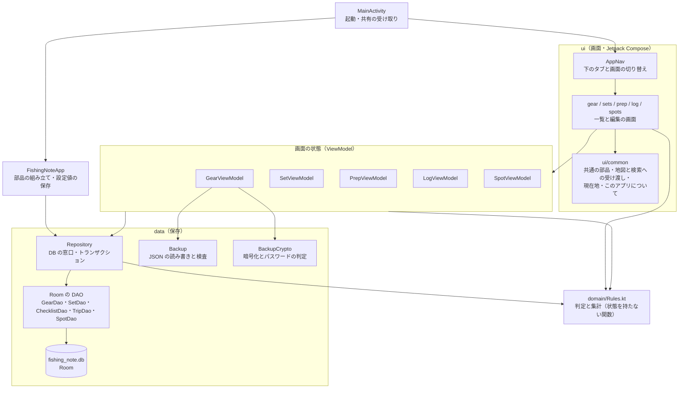

| パッケージ／クラス | 受け持つこと | 参照するもの |
|---|---|---|
| `MainActivity` | 起動、画面の組み立て、地図アプリなどの「共有」の受け取り | `FishingNoteApp`・`ui.AppNav` |
| `FishingNoteApp` | データベースと `Repository` を作る。小さな設定値（最後のバックアップの日など）を SharedPreferences に保存する。初回だけ「いつもの持ち物」の例を入れる | `data` |
| `ui.AppNav` | 下のタブ5つと編集画面の切り替え。共有を受け取ったときに釣り場の保存画面を開く | 各画面 |
| `ui.gear`・`ui.sets`・`ui.prep`・`ui.log`・`ui.spots` | 各タブの一覧と編集の画面、その ViewModel | `ui.common`・`data`・`domain` |
| `ui.common` | 画面の枠・数の増減・選択肢のチップなどの共通部品、編集の未保存の確認、地図アプリと検索への受け渡し、現在地の取得、このアプリについて、プライバシーポリシーの表示 | `domain` |
| `data` | Room の表と DAO、`Repository`、バックアップの JSON（`Backup`）と暗号化（`BackupCrypto`） | `domain`（チェックリストの作成と初期値） |
| `domain` | 判定・検索・集計・地図の値の判定・入力の候補（`Rules.kt`） | `data` の表のクラス（データの型だけ） |

### 2.2 責任の分担

| クラス | 層 | 責任 | 持たない責任 |
|---|---|---|---|
| 各画面（`GearListScreen` など） | 画面 | 表示、操作の受け付け、確認の窓、入力の上限での切り詰め、保存先を選ぶ画面・権限の確認の呼び出し | 表の読み書き、判定のロジック |
| `GearViewModel` | 画面の状態 | 道具の一覧の状態（検索語・絞り込み・件数）、バックアップの保存（画面を回しても止めない）と読み込みの検査 | 暗号の方式、JSON の形式 |
| `SetViewModel`・`PrepViewModel`・`LogViewModel`・`SpotViewModel` | 画面の状態 | 各タブの一覧の状態、保存・削除の呼び出し。チェックリストの並び（`PrepViewModel`）、ワンタップ記録の「元に戻す」の控え（`LogViewModel`） | 表の読み書き |
| `Repository` | 保存 | DAO の窓口。複数の表をまたぐ書き込みのトランザクション、ワンタップ記録とその取り消し、全件の置き換え | 画面の表示 |
| `Backup` | 保存 | 全データと JSON の相互の変換、読み込む値の検査（件数・ID・長さ・範囲・日付・つながり） | 暗号化、ファイルの読み書き |
| `BackupCrypto` | 保存 | パスワードからの鍵の作成、暗号化と復号、パスワードの判定とパスワードの生成 | ファイルの読み書き、画面 |
| DAO（`GearDao` など） | 保存 | 表ごとの読み書き。数の増減の範囲の制限 | トランザクションの組み立て |
| `Rules.kt` | 判定 | 巻き替え時期・残りの少なさ・検索と表記の正規化・チェックリストの項目名・集計・入力の候補・地図の値と地図のリンクの判定・共有の文の読み取り | 保存、画面 |

## 3. データ

### 3.1 ER 図（Room の表）

データベースは Room の `fishing_note.db`（版 1）。日付は日数（epoch day）、道具の種類は名前の文字列で保存する。

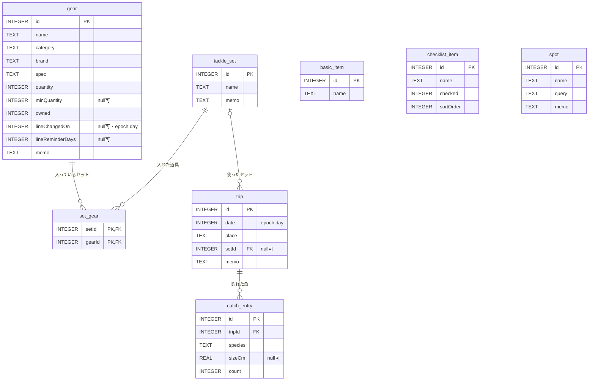

### 3.2 表の一覧

| 表 | 内容 | 消したときのつながり |
|---|---|---|
| `gear` | 道具。名前・種類・メーカー・仕様・数・「残り少ない」のしきい値・持っているか（false は欲しい物）・巻き替え日・知らせる日数・メモ | 消すと `set_gear` の行も消える（CASCADE） |
| `tackle_set` | タックルセット。名前・メモ | 消すと `set_gear` の行も消える（CASCADE）。`trip.setId` は null になる（SET NULL） |
| `set_gear` | セットに入れた道具（セットと道具の組が主キー） | — |
| `basic_item` | いつもの持ち物 | つながりなし |
| `checklist_item` | 今回の持ち物チェックリスト。チェックの有無と並び順 | つながりなし（作り直すと全件を入れ替える） |
| `trip` | 釣行。日付・場所・使ったセット・メモ | 消すと `catch_entry` の行も消える（CASCADE） |
| `catch_entry` | 釣れた魚。種類・最大の大きさ・数 | — |
| `spot` | マイ釣り場。名前・地図で探す値（住所・施設名・緯度経度・地図のリンク）・メモ | つながりなし |

### 3.3 データベースの外に置く値

`FishingNoteApp` が SharedPreferences（名前 `app`、このアプリ専用）に置く。いずれもバックアップの対象外である。

| キー | 内容 |
|---|---|
| `lastBackupDay` | 最後にバックアップを保存した日（epoch day）。保存を勧める表示に使う（REQ-019） |
| `checklistTitle` | 今のチェックリストを作ったセットの名前。準備の画面の見出しに使う |
| `pendingShare` | 共有で受け取った文。釣り場の保存画面が読んだら消す。受け取った直後にアプリが終了しても失わないよう、すぐに書き込む（REQ-016） |
| `seeded` | 「いつもの持ち物」の例を入れ終えた印。利用者が消した後に例を戻さないため（REQ-010） |

### 3.4 バックアップのファイル

| 種類 | 拡張子 | 中身 |
|---|---|---|
| パスワードで守らない | `.json` | 形式名 `fishing-note-backup`・版・8つの表（`gear`・`sets`・`setGear`・`basicItems`・`checklist`・`trips`・`catches`・`spots`）の JSON |
| パスワードで守る | `.fnbk` | 6行のテキスト。1行目 形式名 `fishing-note-backup-encrypted`、2行目 版、3行目 繰り返し回数、4行目 塩、5行目 初期化ベクトル、6行目 暗号文（4〜6行目は Base64）。暗号文の中身は上の JSON |

暗号の方式は [ADR-0003](adr/0003-バックアップの鍵はパスワードから作る.md) に記す。

## 4. 機能一覧

| 機能ID | 機能名 | 主なクラス・関数 | 概要 |
|---|---|---|---|
| FN-001 | 道具の登録・編集・削除 | `GearEditScreen`・`GearViewModel`・`Repository.saveGear`／`deleteGear` | 道具の項目を入力して保存する。削除は確認の後に行う |
| FN-002 | 道具の検索と絞り込み | `filterGear`・`countByFilter`・`normalize` | 語ごとの部分一致と4つの絞り込み、絞り込みごとの件数 |
| FN-003 | 道具の数の増減と取り消し | `GearListScreen.changeQuantity`・`GearDao.addQuantity` | 一覧の「＋」「－」で数を変える。0〜9999 に収める。減らしたら「元に戻す」を出す |
| FN-004 | 道具の状態の判定 | `lineStatus`・`isLowStock` | 巻き替えからの日数と時期、残りの少なさを判定する |
| FN-005 | メーカー・商品名の候補 | `BrandField`・`brandSuggestions`・`KNOWN_MAKERS` | 前に登録した値と主なメーカー名から候補を最大6件出す |
| FN-006 | ネットで調べる | `gearSearchQuery`・`openWebSearch` | 検索語を作り、検索のアプリまたはブラウザに渡す |
| FN-007 | セットの作成・編集・削除 | `SetEditScreen`・`SetViewModel`・`Repository.saveSet`／`deleteSet` | 名前・メモ・入れる道具を保存する。新しいセットが見えない位置に入ったら、そこまで送る |
| FN-008 | チェックリストの作成 | `Repository.prepareChecklist`・`buildChecklistNames` | セットの道具といつもの持ち物から、チェックリストを作り直す |
| FN-009 | チェックリストの操作 | `PrepScreen`・`PrepViewModel` | チェックの付け外し、全部外す、項目の追加、編集中の削除と「元に戻す」、並びの固定 |
| FN-010 | いつもの持ち物の管理 | `PrepViewModel.addBasic`／`removeBasic`・`FishingNoteApp.seedOnce`・`Repository.seedIfEmpty` | 追加・削除と「元に戻す」。初回だけ例を入れる |
| FN-011 | ワンタップ記録 | `QuickCatchCard`・`LogViewModel.quickAdd`・`Repository.addQuickCatch`・`quickSpecies` | 今日の記録へ魚を1匹足す。今日の記録が無ければ作る |
| FN-012 | ワンタップ記録の取り消し | `LogViewModel.undoLastQuick`・`Repository.undoQuickCatch` | 直前の1匹を戻す。ワンタップで作った空の記録は消す |
| FN-013 | 釣行の記録・編集・削除 | `TripEditScreen`・`Repository.saveTrip`／`deleteTrip`・`suggestions` | 日付・場所・セット・メモと釣れた魚を保存する。場所と魚は候補から選べる |
| FN-014 | 釣果の集計 | `summarize`・`monthlyFish`・`catchLine` | 今年の集計、月ごとの数、1回の釣行の要約 |
| FN-015 | 現在地の取得 | `findApproxLocation`・`currentApproxLocation` | おおよその現在地を1回だけ取る。取れなければ理由を返す |
| FN-016 | 近くの釣り場の検索 | `SpotListScreen`・`nearbyGeoUri`・`openNearby`・`isGenuineGoogleMaps` | 現在地と検索語を地図アプリに渡す |
| FN-017 | マイ釣り場の管理と地図表示 | `SpotEditScreen`・`SpotViewModel`・`mapQuery`・`openMap`・`isMapUrl` | 釣り場の保存・編集・削除と、地図アプリでの表示 |
| FN-018 | 共有の受け取り | `MainActivity.receiveShare`・`AppNav`・`parseSharedPlace` | 地図アプリなどの共有から、釣り場の保存画面に名前と地図の値を入れる |
| FN-019 | パスワードの判定と生成 | `BackupCrypto.passwordProblem`／`ruleProblem`／`generatePassword`・`ExportDialog` | 規則と強さの見積もりでパスワードを判定する。推測されにくいパスワードを作る |
| FN-020 | バックアップの保存 | `GearViewModel.startExport`・`Backup.toJson`・`BackupCrypto.encrypt` | 全データを検査してから、暗号化して（または JSON のまま）保存先に書く |
| FN-021 | バックアップの読み込みと検査 | `GearViewModel.readBackupText`・`BackupCrypto.decrypt`・`Backup.fromJson`・`UnlockDialog` | ファイルを読み、復号と検査をして、データベースに触れずに中身を返す |
| FN-022 | 全データの置き換え | `Repository.replaceAll` | 検査済みのデータで全表を置き換える。失敗したら元のまま残す |
| FN-023 | パスワード入力の保護 | `SecretDialogProperties`・`NoCopyTextFields`・`MaskWhenLeaving`・`MaskWhenUnfocused`・`GearViewModel.holdExportPassword` | 画面の撮影・コピー・切り取りを止め、表示したパスワードを伏せ直す。パスワードの配列を使い終わったら消す |
| FN-024 | バックアップの勧め | `BackupReminder`・`FishingNoteApp.lastBackupDay` | 最後の保存から30日を超えたら、道具の一覧の上で保存を勧める |
| FN-025 | このアプリについて | `AboutDialog` | 版・プライバシーポリシー・ライセンスの一覧と全文を出す |
| FN-026 | プライバシーポリシーの生成と表示 | `GeneratePrivacyPolicy`（ビルドのタスク）・`parsePolicy`・`policyProblems`・`PolicyContent` | ビルドのときに原稿から本文を作り、アプリの中で読める形にする |
| FN-027 | 配布前の検査 | `checkReleaseReady`（ビルドのタスク） | 原稿の未記入の欄と仮のパッケージ名が残っていれば、配布用のビルドを止める |
| FN-028 | 画面の共通部品と編集の保護 | `ScreenScaffold`・`Stepper`・`ChoiceChips`・`SaveBar`・`rememberGuardedBack`・`editKey`・`parseNumber` | 押す対象の大きさ、追加ボタンの位置、保存ボタンの固定、変更したまま戻るときの確認、数字の入力の読み取り |

## 5. 画面

### 5.1 画面一覧

下のタブで切り替える画面（SCR-001・003・005・006・008）と、一覧から開く編集画面、確認の窓（ダイアログ）からなる。

| 画面ID | 画面名 | 種類 | 実装（ルート） | 主な操作 |
|---|---|---|---|---|
| SCR-001 | 道具 | タブ | `GearListScreen`（`gear`） | 検索、絞り込み、数の増減、道具を追加、メニュー（バックアップを保存・バックアップから戻す・このアプリについて） |
| SCR-002 | 道具を追加／道具を編集 | 編集画面 | `GearEditScreen`（`gear/{id}`） | 項目の入力、候補の選択、ネットで調べる、保存、削除 |
| SCR-003 | セット | タブ | `SetListScreen`（`sets`） | セットを作る、このセットで準備する |
| SCR-004 | セットを作る／セットを編集 | 編集画面 | `SetEditScreen`（`set/{id}`） | 名前・メモ、入れる道具の選択と絞り込み、保存、削除 |
| SCR-005 | 出発前の準備 | タブ | `PrepScreen`（`prep`） | 持ち物リストを作る・作り直す、チェック、全部外す、項目を足す、編集（項目を消す）、いつもの持ち物の編集 |
| SCR-006 | 釣行の記録 | タブ | `LogScreen`（`log`） | 魚のボタン（ワンタップ記録）、元に戻す、ほかの魚、今日の記録に書き足す、詳しく記録、集計の表示 |
| SCR-007 | 釣行を記録／記録を編集 | 編集画面 | `TripEditScreen`（`trip/{id}`） | 日付・場所・セット・メモ、釣れた魚の行の追加と削除、保存、削除 |
| SCR-008 | 釣り場 | タブ | `SpotListScreen`（`spots`） | 近くの釣り場を地図で探す（7つの語）、マイ釣り場の「地図」、釣り場を保存 |
| SCR-009 | 釣り場を保存／釣り場を編集 | 編集画面 | `SpotEditScreen`（`spot/{id}`） | 名前・地図で探す値・メモ、地図で確かめる、保存、削除 |
| SCR-010 | バックアップを保存 | 確認の窓 | `ExportDialog` | パスワードで守るの切り替え、パスワードを作ってもらう、パスワードの入力と表示、保存先を選ぶ |
| SCR-011 | パスワードを入れてください | 確認の窓 | `UnlockDialog` | パスワードの入力と表示、開く |
| SCR-012 | バックアップから戻す | 確認の窓 | `ConfirmDialog`（`GearListScreen` 内） | 中身の件数の確認、置き換える |
| SCR-013 | このアプリについて | 確認の窓 | `AboutDialog` | 版の表示、プライバシーポリシーの全文、ライセンスの一覧と全文 |
| SCR-014 | どのセットで準備しますか | 確認の窓 | `ChooseSetDialog` | セットを選ぶ、セットを使わない |
| SCR-015 | ほかの魚を1匹足す | 確認の窓 | `OtherFishDialog` | 前に記録した魚を押す、魚の種類を入れて足す |
| SCR-016 | 削除の確認 | 確認の窓 | `ConfirmDialog`（各編集画面） | 道具・セット・記録・釣り場を消す |
| SCR-017 | セットで準備 | 確認の窓 | `ConfirmDialog`（`SetListScreen` 内） | チェックリストを作り直す |
| SCR-018 | チェックを全部外す | 確認の窓 | `ConfirmDialog`（`PrepScreen` 内） | すべてのチェックを外す |
| SCR-019 | 保存せずに戻りますか | 確認の窓 | `rememberGuardedBack` | 保存せずに戻る、編集を続ける |
| SCR-020 | 日付の選択 | 確認の窓 | `DateField`（`DatePickerDialog`） | 日付を決める、日付を消す（巻き替え日だけ） |

### 5.2 アプリの外の画面

アプリが呼び出す、ほかのアプリや Android の画面である。

| ID | 画面 | 呼び出す場面 |
|---|---|---|
| EXT-001 | 地図アプリ（Google マップ、または利用者が選んだアプリ） | 近くの釣り場を探す、マイ釣り場の「地図」、地図で確かめる |
| EXT-002 | 検索のアプリ・ブラウザ | ネットで調べる |
| EXT-003 | 保存先を選ぶ画面（Android の文書の作成） | バックアップを保存 |
| EXT-004 | ファイルを選ぶ画面（Android の文書を開く） | バックアップから戻す |
| EXT-005 | 位置情報の権限の確認（Android） | 近くの釣り場を探すボタンを、権限が無い状態で押したとき |
| EXT-006 | このアプリの設定画面（Android） | 権限がオフで探した後の案内の「設定」 |
| EXT-007 | アプリを選ぶ画面（Android） | Google マップが無い・署名が合わない端末で、地図アプリに渡すとき |
| EXT-008 | 共有の送り元（地図アプリなど） | 共有の宛先に「釣り場として保存」を選んだとき（アプリへ入ってくる） |

### 5.3 画面遷移図

タブの画面どうしは、下のタブでいつでも切り替えられる（タブごとのスクロール位置などは残す）。編集画面と確認の窓では、下のタブを出さない。

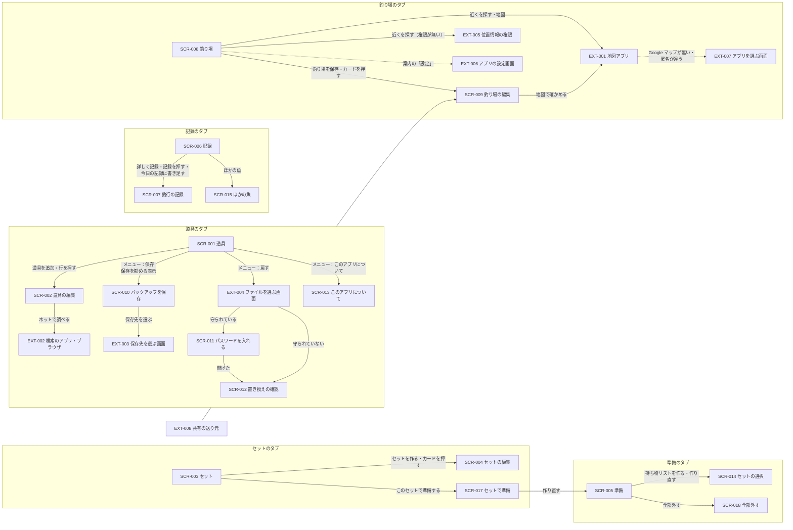

- 編集画面（SCR-002・004・007・009）は、保存・削除・戻るで元の一覧に戻る
- SCR-017 で「作り直す」を押すと、チェックリストを作ってから準備のタブ（SCR-005）へ移る
- 共有を受け取ったとき、編集画面を開いている間は切り替えない。保存か破棄で一覧に戻ったときに、釣り場のタブへ移って SCR-009 を開く（編集中の入力を確認なしに失わないため）
- 編集画面（SCR-002・004・007・009）からは、削除で SCR-016（削除の確認）を、変更したまま戻るときに SCR-019（保存せずに戻るか）を開く。図では省く
- SCR-020（日付の選択）は SCR-002（巻き替え日）と SCR-007（日付）から開く。図では省く

### 5.4 画面の操作の決まり

屋外で、片手・濡れた手・手袋で操作するため、全画面で次の決まりにする（REQ-024〜REQ-026、[ADR-0004](adr/0004-押した結果で画面の上の物の位置を動かさない.md)）。

| 決まり | 実装 |
|---|---|
| 押す対象は 56dp 以上 | `TouchTarget = 56.dp`。チップは高さ 56dp 以上・間隔 12dp（`ChoiceChips`）。主なボタンは `BigButtonHeight = 60.dp`。ワンタップ記録の魚のボタンは高さ 76dp |
| 文字を標準より一段大きくする | 本文（`bodyLarge`）は 18sp（`Theme.kt`） |
| 追加ボタンは上のバーに文字付きで置く | `ScreenScaffold` の `add`。右下に浮かせると、一覧の行の「＋」や「地図」のボタンに重なるため |
| チェックリストの並びは、画面を開いたときの「まだの物が上」で固定する | `PrepViewModel.fixedOrder`。チェックしても行を動かさない。後から足した項目は最後に並べる。タブを離れたときに並びを捨て、次に開いたときに並べ直す（画面を回したときは残す） |
| ワンタップ記録の魚のボタンの並びは、画面を開いたときの並びで固定する | `LogScreen` の `buttons`。記録を読み終える前は出さない（既定の並びを一瞬出してから入れ替えないため） |
| ワンタップ記録の「元に戻す」は、魚のボタンのすぐ上の高さを固定した行に出す | 画面下のお知らせにすると「ほかの魚」を隠すため。説明の行と差し替えるので、ボタンの位置は動かない |
| 現在地を探している間は、見出しの文だけを差し替える | 説明文の行数を変えず、探すボタンの位置を動かさない |
| 道具の一覧では、検索欄と絞り込みも一覧と一緒にスクロールする | 上に固定すると、横向きで道具が1行しか見えないため |
| 数の増減ボタンは、名前の下の行に置く | 名前の横に置くと、名前が語の途中で折り返すため |
| 保存ボタンは編集画面の下端に固定する | `SaveBar`。スクロールしなくても押せる |
| 変更したまま戻るときは確認する | `rememberGuardedBack`。端末の戻る操作も同じ確認を通す。変更の有無は `editKey` で入力の値を連結した文字列を比べる（区切りの文字を入力しても別の入力と同じにならないよう、値ごとに種類と長さを付ける） |
| 1件単位の軽い操作は「元に戻す」を出す | 数を減らす・チェックリストから外す・いつもの持ち物を消す（画面下のお知らせ）、ワンタップ記録（カードの中）。チェックリストから続けて外した分は、まとめて戻す |
| 関係するデータも消える操作は確認を出す | 道具・セット・記録・釣り場の削除、チェックリストの作り直し・全部外す、バックアップからの置き換え。チェックリストの項目を消すボタンは「編集」中だけ出す |

## 6. 処理の流れ

### 6.1 ワンタップ記録と取り消し（FN-011・FN-012）

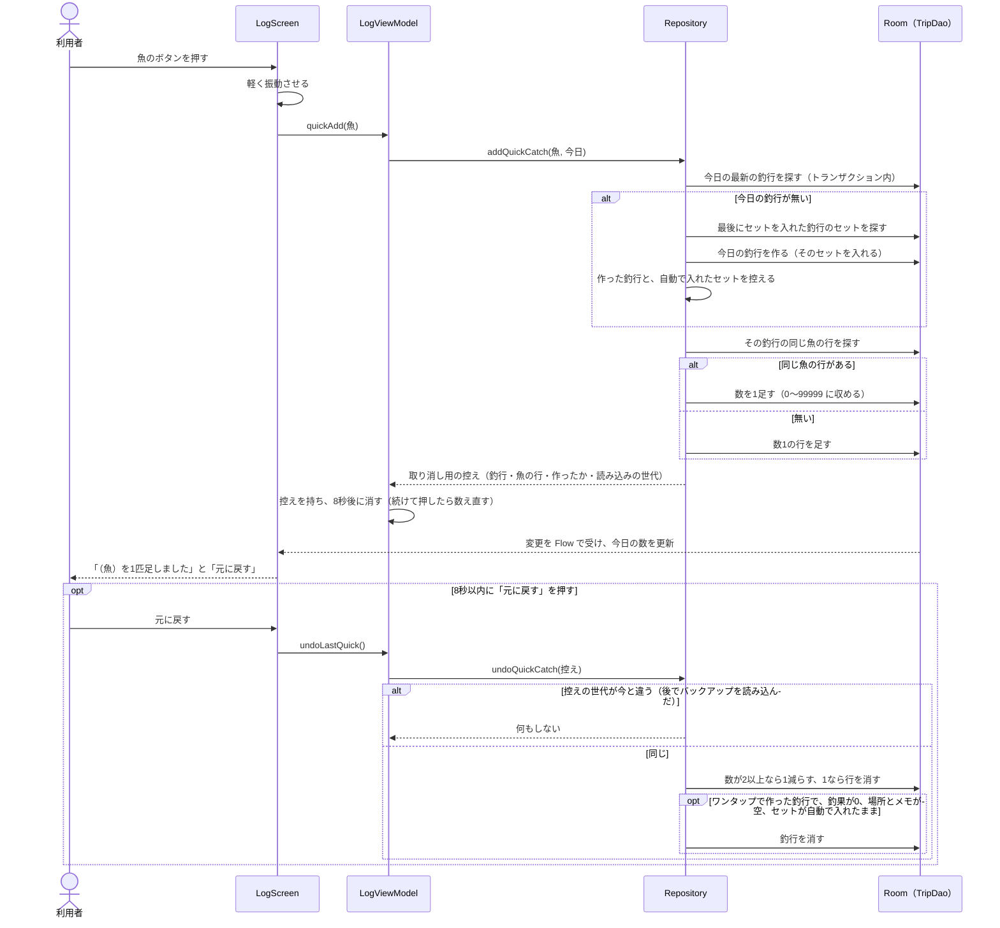

- 取り消しで行ごと消すのは、今の数が1のときだけにする。取り消しの前に同じ魚がまた足されていても、その分は消さない
- 利用者が先に作っておいた釣行や、後から場所・メモ・セットを書き足した釣行は、釣果が0になっても残す
- 作った釣行の控えはメモリの中だけに持つ。アプリが終了すると控えを忘れ、釣行を残す側に倒れる
- 魚のボタンの並びは `quickSpecies`（前に記録した魚の多い順に6つ、足りなければ「アジ・サバ・イワシ・メバル・カサゴ・シーバス」で埋める）で決め、画面を開いたときの並びで固定する

### 6.2 セットからチェックリストを作る（FN-008・FN-009）

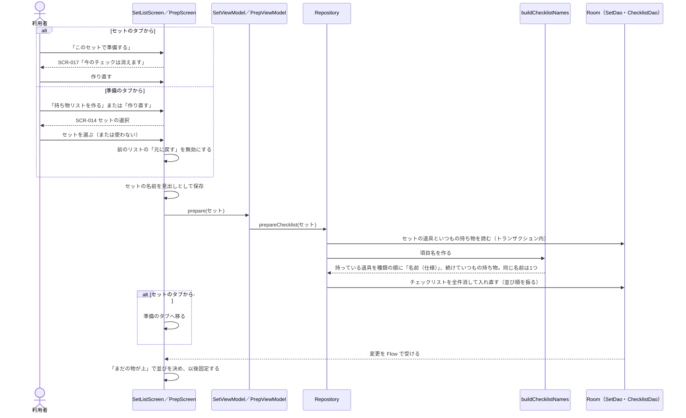

### 6.3 近くの釣り場を探す（FN-015・FN-016）

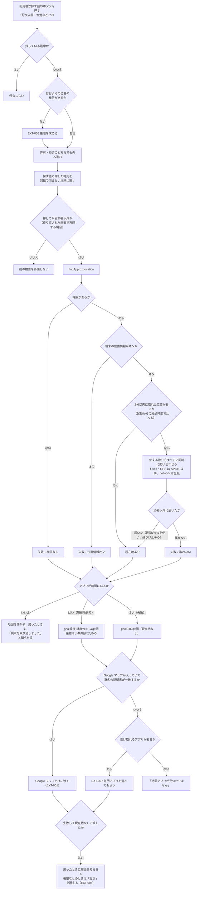

- 現在地はその場で地図アプリに渡すだけで、保存しない（REQ-023）
- 渡す先を Google マップに絞るのは、`geo:` を受け取れると名乗る別のアプリに、黙って現在地を渡さないためである。パッケージ名だけでなく、署名の証明書（SHA-256）も確かめる。合わない場合は毎回選んでもらう側に倒れるだけで、使えなくはならない
- 保存した釣り場を地図で開くとき（マイ釣り場の「地図」、SCR-009 の「地図で確かめる」）も、同じ絞り方をする（`openMap`）。値が地図のリンク（`isMapUrl` を満たす物）ならそのまま開き、緯度経度なら名前をラベルに付け、それ以外は住所・施設名として検索する。値が空なら名前で探す

### 6.4 地図アプリの共有を受け取る（FN-018）

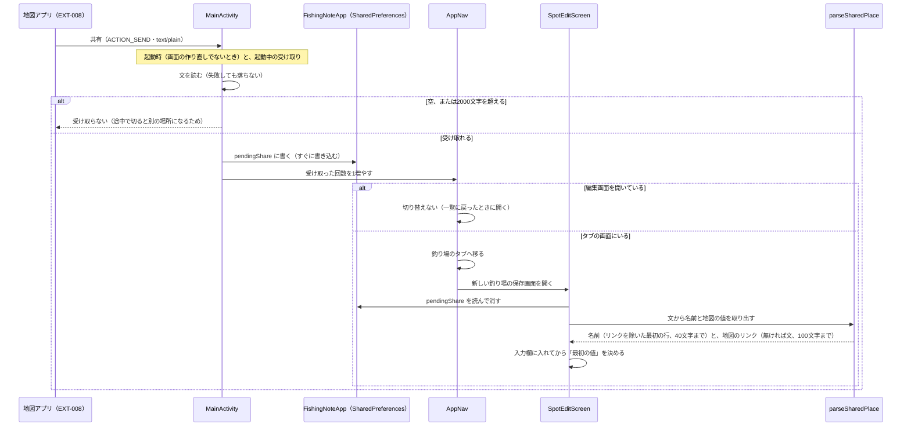

- 地図のリンクとして扱うのは、https で、ホスト名が決まった一覧（`maps.app.goo.gl`・`maps.google.com` など8つ）と完全に一致し、決まったパスで始まる物だけである。利用者情報・443 以外のポート・`..` やエンコードした区切りを含むパスは受け付けない
- 見えない文字（ゼロ幅の文字・文字の向きを変える制御文字）は取り除く（表示の偽装を防ぐため）
- 釣り場として残るのは、利用者が保存を押した場合だけである

### 6.5 バックアップを保存する（FN-019・FN-020・FN-023）

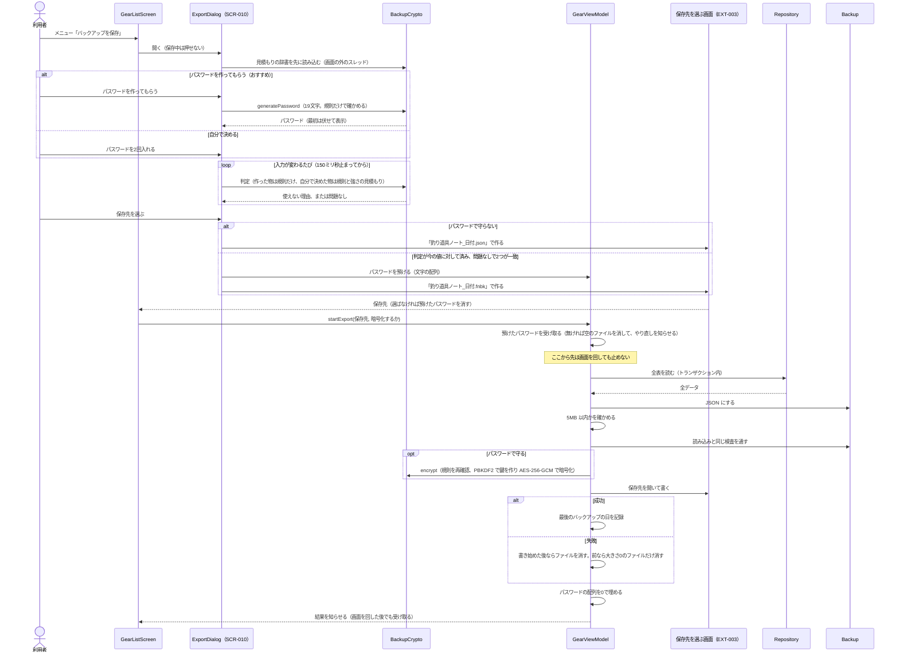

- 判定は画面のスレッドの外で、打ち終わってから行う。押した時点の値に対する判定が済んでいなければ、保存に進まない
- 暗号化に入る道は、SCR-010 の「保存先を選ぶ」の1つだけである。暗号化の直前（`encrypt`）は規則だけで確かめるため、別の入口を足すときは、画面と同じ判定（規則と見積もり）を必ず通す
- 暗号文はメモリの中で作り終えてから保存先を開く。保存中は「保存しています…」を出し続ける

### 6.6 バックアップから戻す（FN-021・FN-022）

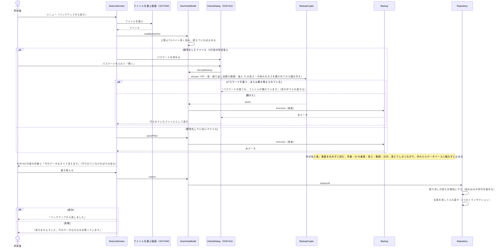

- 読み込みでは、パスワードの規則を確かめない。前の版の規則で保存したバックアップも開けるようにするためである
- 表が欠けているファイルは、空の表として受け入れずに止める。受け入れると、読み込みが正常に終わったうえで全データが消えるため

### 6.7 ネットで調べる（FN-006）

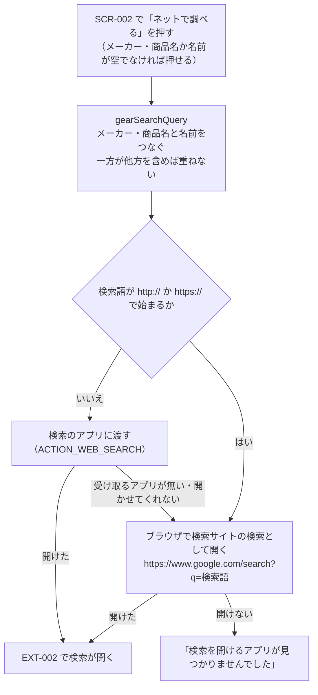

- アプリ自身は通信しない。検索語は、検索のアプリまたはブラウザが検索サイトに送る。画面に「言葉は検索サイトに送られます」と示す（[ADR-0002](adr/0002-インターネットの権限を持たずネット検索はブラウザに渡す.md)）
- 検索語が URL の形のとき、検索のアプリはそのサイトを開くことがあるため、検索サイトの検索として開く

### 6.8 プライバシーポリシーの生成と表示（FN-025〜FN-027）

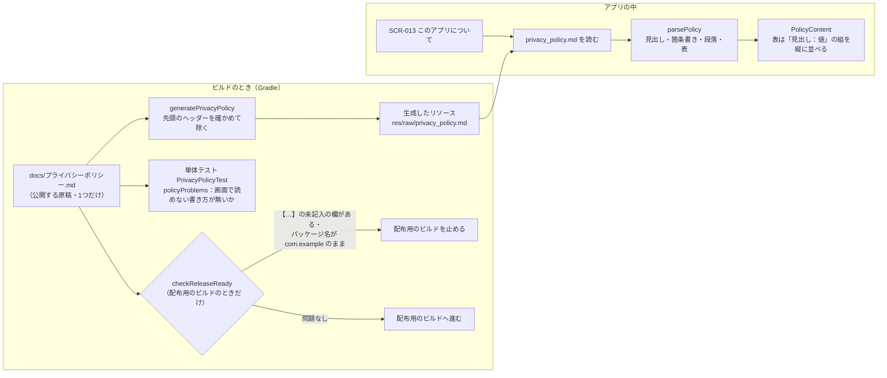

- 原稿を写す作業をなくし、公開する原稿とアプリの中の文がずれないようにする（[ADR-0005](adr/0005-プライバシーポリシーは1つの原稿からビルド時に作る.md)）
- 画面で読める書き方は、見出し（`#`・`##`）・箇条書き（`- `）・表・段落だけである。それ以外は記号のまま画面に出るため、単体テストで止める
- 原稿だけを直したときも単体テストがやり直されるよう、原稿をテストの入力に登録している

## 7. 情報がアプリの外へ出る場面

アプリ自身はインターネットの権限を持たない。情報がアプリの外へ出るのは、利用者の操作による次の3つの出口だけである（REQ-021）。

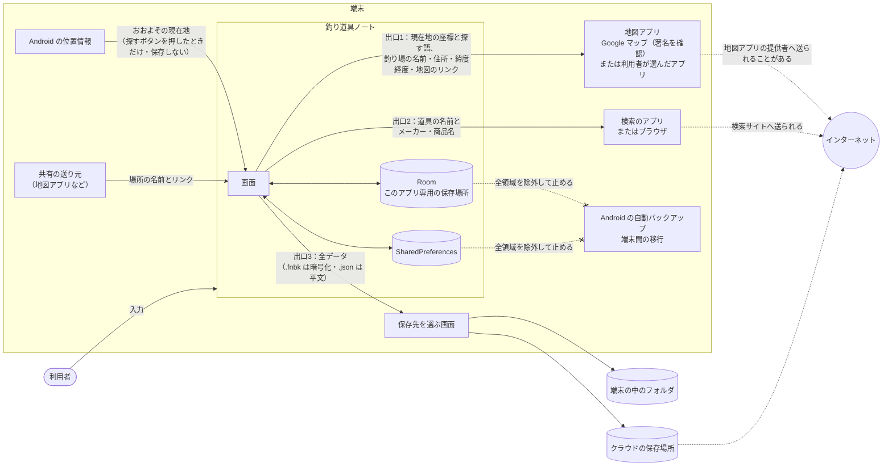

| 出口 | きっかけの操作 | 渡す情報 | 渡す先 | 渡した後 |
|---|---|---|---|---|
| 出口1 | SCR-008 の探す語のボタン、マイ釣り場の「地図」、SCR-009 の「地図で確かめる」 | おおよその現在地（小数4桁）と探す語。釣り場の名前・住所・施設名・緯度経度・地図のリンク | Google マップ（署名を確認）。無い・合わない端末では、利用者が毎回選んだアプリ | 地図アプリの提供者に送られることがある。扱いは地図アプリの設定による |
| 出口2 | SCR-002 の「ネットで調べる」 | 道具の名前と、メーカー・商品名 | 検索のアプリ、無ければブラウザ | 検索サイトに送られる |
| 出口3 | SCR-010 の「保存先を選ぶ」 | 全データ（釣り場を含む） | 利用者が選んだ保存先（端末の中のフォルダ、クラウド） | 保存先のサービスの方針で扱われる。パスワードで守らない物は誰でも読める |

- Android 標準の自動バックアップと端末間の移行は、Android 11 以前は `android:allowBackup="false"`、Android 12 以降は `data_extraction_rules.xml` で、クラウドへのバックアップと端末間の移行の両方から全領域を除外する（`allowBackup="false"` だけでは、機種によって端末間の移行が止まらないため）
- 入ってくる値（共有の文・バックアップのファイル）は、6.4・6.6 の検査を通した物だけを使う（REQ-029）

## 8. 要件と機能の対応

| 要件ID | 機能・画面 |
|---|---|
| REQ-001 | FN-001、FN-004、SCR-001、SCR-002、SCR-016、SCR-020 |
| REQ-002 | FN-002、SCR-001 |
| REQ-003 | FN-003、FN-028、SCR-001 |
| REQ-004 | FN-004、SCR-001、SCR-002 |
| REQ-005 | FN-005、SCR-002 |
| REQ-006 | FN-006、SCR-002 |
| REQ-007 | FN-007、FN-002、SCR-003、SCR-004、SCR-016 |
| REQ-008 | FN-008、SCR-003、SCR-005、SCR-014、SCR-017 |
| REQ-009 | FN-009、SCR-005、SCR-018 |
| REQ-010 | FN-010、SCR-005 |
| REQ-011 | FN-011、FN-012、SCR-006、SCR-015 |
| REQ-012 | FN-013、SCR-006、SCR-007、SCR-016、SCR-020 |
| REQ-013 | FN-014、SCR-006 |
| REQ-014 | FN-015、FN-016、SCR-008 |
| REQ-015 | FN-017、SCR-008、SCR-009、SCR-016 |
| REQ-016 | FN-018、SCR-009 |
| REQ-017 | FN-019、FN-020、FN-023、SCR-001、SCR-010 |
| REQ-018 | FN-021、FN-022、FN-023、SCR-001、SCR-011、SCR-012 |
| REQ-019 | FN-024、SCR-001 |
| REQ-020 | FN-025、FN-026、SCR-013 |
| REQ-021 | FN-006、FN-016、FN-017、FN-020 |
| REQ-022 | FN-020、FN-022 |
| REQ-023 | FN-015、FN-016、FN-017 |
| REQ-024 | FN-028 |
| REQ-025 | FN-009、FN-011、FN-028 |
| REQ-026 | FN-003、FN-009、FN-010、FN-012、FN-028、SCR-012、SCR-016〜SCR-019 |
| REQ-027 | FN-009、FN-012、FN-020、FN-028 |
| REQ-028 | FN-003、FN-011、FN-028 |
| REQ-029 | FN-018、FN-020、FN-021 |
| REQ-030 | FN-019、FN-020、FN-021、FN-023 |
| REQ-031 | FN-028 |
| REQ-032 | FN-002、FN-004、FN-005、FN-008、FN-014 |
| REQ-033 | FN-026、FN-027 |
