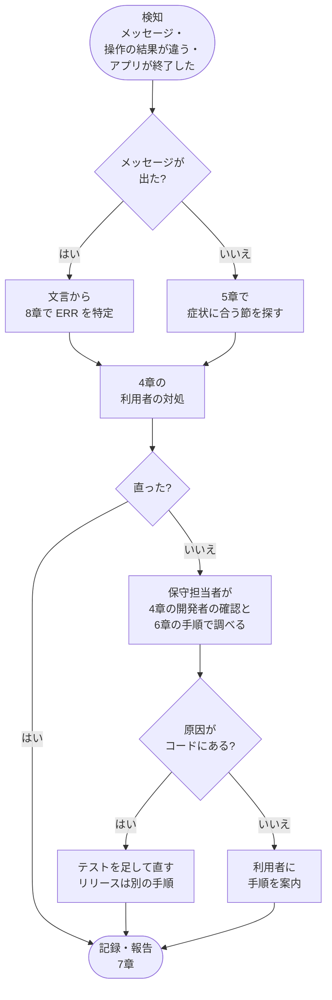

# 釣り道具ノート 障害対応手順書

## 文書情報

| 項目 | 内容 |
|---|---|
| 文書名 | 障害対応手順書 |
| 文書ID | OM-002 |
| システム名 | 釣り道具ノート |
| 版 | 1.1 |
| 作成日 | 2026-11-25 |
| 状態 | 承認済 |

## 改版履歴

| 版 | 日付 | 変更内容 |
|---|---|---|
| 1.0 | 2026-11-25 | 新規作成 |
| 1.1 | 2026-11-26 | ERR-007・ERR-011・ERR-026・ERR-031 の「確かめるテスト」を、その条件を確かめるテストが無いことと、条件を判定するコードの場所に直した（6.1・8章も同じ）。状態を承認済に変更 |

## 1. 目的と対象

### 1.1 目的

アプリがメッセージを出した場合や、操作の結果が想定と違う場合に、原因を切り分けて復旧するための手順を示す。

### 1.2 使う人と使う場面

| 使う人 | 場面 |
|---|---|
| 利用者 | メッセージが出たとき、4章の「利用者の対処」で直せるかを確かめる |
| 保守担当者 | 問い合わせを受けたとき、3章の順に切り分け、4章の「開発者の確認」と6章の手順で原因を調べる |

### 1.3 対象範囲

詳細設計書（DD-001）1章のエラー（ERR-001〜ERR-032）と、エラーIDの付かない症状（5章）を対象とする。

このアプリはインターネットに接続せず、データは端末の中のデータベース（`fishing_note.db`）と、利用者が保存したバックアップのファイルにだけある。障害の影響は、その端末のデータと、利用者が選んだ保存先のファイルに限られる。

### 1.4 作業の前の注意

- **端末上のテスト（`connectedDebugAndroidTest`）を実行すると、その端末のアプリのデータが消える。** 利用者のデータが入った端末では実行しない。調べるときはエミュレータか検証用の端末を使う
- 利用者のデータベースやバックアップのファイルを預かる場合は、中に釣り場（位置）が含まれる。調べ終えたら消す。再現にはなるべく見本データ（README「見本データの入れ方」）を使う
- バックアップから戻す操作（SCR-012 の「置き換える」）は、今のデータを全部消して置き換える。復旧のために勧める前に、今のデータのバックアップを先に保存してもらう

## 2. 障害時の基本の流れ



## 3. 切り分けの順番

アプリはログを出力しない。手がかりは次の5つだけであるため、上から順に確かめる。

| 順 | 確かめる物 | 見ること | 次に進む先 |
|---|---|---|---|
| 1 | 表示されたメッセージ | 文言（画面下のお知らせは数秒で消えるため、出たらすぐ控えてもらう）。どの画面で出たか | 8章の表から ERR を特定 |
| 2 | 直前の操作 | バックアップの保存・読み込み、近くの釣り場を探す、地図・ネットで調べる、共有、保存ボタン | 4章の該当の節 |
| 3 | アプリの版 | 「このアプリについて」（SCR-013）に出る版 | 7章の記録 |
| 4 | 端末の状態 | Android の版、位置情報の権限と設定、Google マップと検索のアプリが入っているか、空き容量 | ERR-020〜ERR-025 |
| 5 | アプリが終了したか | 端末のクラッシュの記録（6.2） | 5.1 |

## 4. エラー別の対応手順

各節の文言は、コードが表示する文言をそのまま示す。「…」は実行時に値が入る部分を表す。テストのコマンドは6.1、adb の手順は6章を参照する。

### `ERR-001` パスワードの規則に合わない

| 項目 | 内容 |
|---|---|
| 事象 | SCR-010 で「保存先を選ぶ」を押すと、パスワードの欄の下に、DD-001 1.1 の文言のどれか（例：「パスワードは12文字以上にしてください」）が出て、保存先を選ぶ画面に進まない |
| 影響 | 保存されない。データは変わらない |
| 想定原因 | 12文字未満、全角や空白を含む、よくある言葉に数字や記号を足しただけ、文字の種類が5種類未満、数字だけ、並んだ文字だけ |
| 利用者の対処 | 「パスワードを作ってもらう（おすすめ）」を押し、「パスワードを表示する」で紙に書き写してから保存する。自分で決める場合は、文言に合わせて直す |
| 開発者の確認 | 文言から `BackupCrypto.ruleProblem`（`data/BackupCrypto.kt:74-87`）のどの判定かを特定する。パスワードそのものは聞かない（似た形の別の文字列で再現する） |
| 確かめるテスト | `BackupCryptoTest.short_password_is_not_allowed`、`BackupCryptoTest.weak_or_unstable_passwords_are_refused` |
| 記録すること | 出た文言。パスワードは記録しない |
| 関連 | FN-019、SCR-010 |

### `ERR-002` 推測されやすいパスワード

| 項目 | 内容 |
|---|---|
| 事象 | 「推測されやすいパスワードです。「パスワードを作ってもらう」を使うか、もっと長く、人が思いつきにくいものにしてください」と出る |
| 影響 | 保存されない |
| 想定原因 | 規則は満たすが、辞書の言葉・名前・日付・キーボードの並びなどの組み合わせで、強さの見積もり（zxcvbn4j）が一番上の段階に届かない |
| 利用者の対処 | 「パスワードを作ってもらう（おすすめ）」を使う |
| 開発者の確認 | 自分で決めたパスワードだけが見積もりの対象であることを確かめる（作った物は規則だけ。`ui/gear/GearScreens.kt:789`） |
| 確かめるテスト | `BackupCryptoTest.weak_or_unstable_passwords_are_refused`、端末では `PasswordCheckTimingTest.check_finishes_quickly_on_device` |
| 記録すること | 出た文言、アプリの版 |
| 関連 | FN-019、SCR-010 |

### `ERR-003` パスワードの強さを確かめられない

| 項目 | 内容 |
|---|---|
| 事象 | 「パスワードの強さを確かめられませんでした。「パスワードを作ってもらう」を使ってください」と出る |
| 影響 | 自分で決めたパスワードでは保存できない。作ってもらったパスワードなら保存できる |
| 想定原因 | 見積もりの部品が例外か `LinkageError` を出した（辞書を読めない、メモリが足りないなど。`data/BackupCrypto.kt:128-131`） |
| 利用者の対処 | 「パスワードを作ってもらう（おすすめ）」を使う。続く場合はアプリを終了して開き直す |
| 開発者の確認 | 6.2 でクラッシュの記録が無いかを見る。同じ端末の Android の版で `PasswordCheckTimingTest` を実行し、見積もりが動くかを確かめる |
| 確かめるテスト | `PasswordCheckTimingTest.check_finishes_quickly_on_device`、`BackupCryptoTest.generated_passwords_are_valid_and_different` |
| 記録すること | 端末の機種と Android の版、アプリの版、再現するか |
| 関連 | FN-019、SCR-010 |

### `ERR-004` 確認のパスワードが違う

| 項目 | 内容 |
|---|---|
| 事象 | 「もう一度入れる」の欄の下に「2つのパスワードが違います」と出る |
| 影響 | 保存されない |
| 想定原因 | 2つの欄の入力が違う。64文字を超えて入れた（どちらも64文字で切る） |
| 利用者の対処 | 「パスワードを表示する」で2つを見比べ、同じにする |
| 開発者の確認 | 不要（入力の誤り） |
| 確かめるテスト | 画面の操作で確かめる（自動テストなし） |
| 記録すること | 不要 |
| 関連 | FN-019、SCR-010 |

### `ERR-005` パスワードを作れない

| 項目 | 内容 |
|---|---|
| 事象 | 「パスワードを作れませんでした。もう一度押すか、自分で決めてください」と出る |
| 影響 | パスワードが入らない。保存はまだ始まっていない |
| 想定原因 | 作ったパスワードが100回続けて規則に当たった（`data/BackupCrypto.kt:201-206`）。通常は起きない |
| 利用者の対処 | もう一度押す。続く場合は自分で決める |
| 開発者の確認 | 再現する場合は、`GENERATE_CHARS` と `ruleProblem` の変更が無いかを差分で確かめる |
| 確かめるテスト | `BackupCryptoTest.generated_passwords_are_valid_and_different` |
| 記録すること | アプリの版、押した回数 |
| 関連 | FN-019、SCR-010 |

### `ERR-006` 預けたパスワードが失われた

| 項目 | 内容 |
|---|---|
| 事象 | 保存先を選んで戻った後、「保存できませんでした。お手数ですが、もう一度保存してください」と出る |
| 影響 | 保存されない。保存先にできた大きさ0のファイルは消す（大きさが分からない場合は残る） |
| 想定原因 | 保存先を選んでいる間に、端末がメモリ不足などでアプリを終了させ、ViewModel に預けたパスワードが失われた（`ui/gear/GearScreens.kt:224-230`） |
| 利用者の対処 | もう一度「バックアップを保存」からやり直す。保存先に「釣り道具ノート_（日付）.fnbk」の空のファイルが残っていれば消す |
| 開発者の確認 | 保存先を選ぶ画面を開いている間に、端末の開発者向けオプションにある、離れた画面（アクティビティ）をすぐに破棄する設定などでアプリの画面を破棄させ、再現を試みる |
| 確かめるテスト | 画面の操作で確かめる（自動テストなし） |
| 記録すること | 保存先の種類（端末のフォルダ・クラウド）、端末の機種 |
| 関連 | FN-020、FN-023 |

### `ERR-007` データが多すぎて保存できない

| 項目 | 内容 |
|---|---|
| 事象 | 「保存できませんでした：データが多すぎて、読み込める大きさのバックアップを作れません」と出る |
| 影響 | 保存されない。大きさ0のファイルだけを消す |
| 想定原因 | 全データの JSON が 5MB（5,242,880 バイト）を超えた |
| 利用者の対処 | 不要な記録・メモを減らしてから保存する。減らせない場合は保守担当者へ連絡する |
| 開発者の確認 | 6.3 でデータベースを取り出し、表ごとの件数とメモの長さを数える。上限（`Backup.MAX_BYTES`、`data/Backup.kt:117`）を上げる場合は、読み込みの上限（`ui/gear/GearScreens.kt:288`）と復号の上限も同時に見直す |
| 確かめるテスト | 自動テストなし（コードで確認：`ui/gear/GearScreens.kt:275`。`Backup.MAX_BYTES` との比較） |
| 記録すること | 表ごとの件数（6.3 の SQL）。中身は記録しない |
| 関連 | FN-020 |

### `ERR-008` 書き出し前の検査に通らない

| 項目 | 内容 |
|---|---|
| 事象 | 「保存できませんでした：」に続けて、ERR-012〜ERR-016 の文言が出る。多いのは「保存できませんでした：バックアップの「道具」に、範囲外の値があります」または「…「釣果」…」 |
| 影響 | 保存されない（書いても読み戻せないバックアップを作らないため）。データベースはそのまま |
| 想定原因 | 道具の編集画面の「数」を 9,999 より大きく、または釣行の編集画面の魚の「数」を 99,999 より大きくして保存した（DD-001 6.1 の既知の制限）。ほかに、表の件数が 20,000 を超えた |
| 利用者の対処 | 道具の場合：一覧の「－」を1回押すと 9,999 になる。一覧に「＋」「－」が出ない道具は、編集画面の「－」で 9,999 以下に戻す。魚の場合：その記録を開き、魚の行を消して入れ直すか、「－」で 99,999 以下に戻す。直したらもう一度保存する |
| 開発者の確認 | 6.3 の SQL で範囲外の行を探す。文言の「…」（表の呼び名）で対象の表が分かる |
| 確かめるテスト | `RepositoryTest.quantity_never_goes_below_zero`、`RepositoryTest.catch_count_stays_within_backup_range`（一覧とワンタップ記録の経路が範囲に収まることを確かめる。編集画面の経路を確かめるテストは無い） |
| 記録すること | 出た文言、どの画面で数を変えたか |
| 関連 | FN-001、FN-013、FN-020、FN-028 |

### `ERR-009` 保存先に書けない

| 項目 | 内容 |
|---|---|
| 事象 | 「保存できませんでした：保存先を開けませんでした」、または「保存できませんでした：」に続けて例外の文言（文言が無ければ「原因が分かりませんでした」）が出る |
| 影響 | 保存されない。書き込みを始めた後の失敗なら、壊れたファイルを消す |
| 想定原因 | 保存先のアプリ（クラウドの保存場所など）が書き込みを受け付けない。通信の切断、空き容量の不足、保存先のアカウントの期限切れ |
| 利用者の対処 | 端末の中のフォルダ（「ダウンロード」など）を保存先に選んで保存し直す。クラウドに置く場合は、その後でクラウドのアプリから移す |
| 開発者の確認 | 例外の文言から、`openOutputStream` が null か、書き込み中の例外かを分ける（`ui/gear/GearScreens.kt:278-279`）。同じ保存先のアプリで再現するかを確かめる |
| 確かめるテスト | 画面の操作で確かめる（自動テストなし） |
| 記録すること | 出た文言、保存先のアプリ、通信の状態 |
| 関連 | FN-020、EXT-003 |

### `ERR-010` ファイルを開けない

| 項目 | 内容 |
|---|---|
| 事象 | 「ファイルを開けませんでした」、または「読み込めませんでした」と出る |
| 影響 | 読み込まない。データベースには触れない |
| 想定原因 | 選んだファイルが消えた・移動した。クラウドのファイルを取得できない（通信の切断）。保存先のアプリが読み取りを許さない |
| 利用者の対処 | ファイルを端末の中のフォルダに保存し直してから選び直す |
| 開発者の確認 | 同じファイルを PC にコピーして、大きさと先頭の行（6.4）を確かめる。端末の中のフォルダから読めればアプリの問題ではない |
| 確かめるテスト | 画面の操作で確かめる（自動テストなし） |
| 記録すること | 出た文言、ファイルの置き場所 |
| 関連 | FN-021、EXT-004 |

### `ERR-011` ファイルが大きすぎる

| 項目 | 内容 |
|---|---|
| 事象 | 「ファイルが大きすぎます（このアプリのバックアップではないかもしれません）」、または「ファイルが大きすぎます」と出る |
| 影響 | 読み込まない。データベースには触れない |
| 想定原因 | 別のファイル（写真など）を選んだ。暗号化していないファイルが 5,242,880 バイト、どのファイルでも 6,994,600 バイトを超える。暗号化したファイルの中身が 5MB を超える |
| 利用者の対処 | ファイル名が「釣り道具ノート_（日付）.json」か「…fnbk」かを確かめて選び直す |
| 開発者の確認 | ファイルの大きさを確かめる（6.4）。このアプリが書いた物なら書き出しの上限で止まるはずなので、別のファイルか、外で書き換えた物を疑う |
| 確かめるテスト | 自動テストなし（コードで確認：`ui/gear/GearScreens.kt:292-294`・`:305`、`data/BackupCrypto.kt:262`。`Backup.MAX_BYTES` との比較） |
| 記録すること | ファイルの大きさ（バイト）、拡張子 |
| 関連 | FN-021 |

### `ERR-012` バックアップの形式が違う

| 項目 | 内容 |
|---|---|
| 事象 | 「バックアップのファイルとして読めません」「このアプリのバックアップではありません」「対応していない版のバックアップです（版 …）」のどれかが出る |
| 影響 | 読み込まない。データベースには触れない |
| 想定原因 | 別のアプリの JSON・テキストを選んだ。ファイルが途中で切れた。新しい版のアプリで保存したファイルを古い版で開いた |
| 利用者の対処 | 正しいファイルを選び直す。「版 …」が出た場合は、アプリを最新の版にしてから開く |
| 開発者の確認 | 先頭（6.4）で `"format": "fishing-note-backup"` と `"version": 1` を確かめる。JSON として閉じているか（末尾が `}` か）を確かめる |
| 確かめるテスト | `RepositoryTest.broken_backup_is_rejected_before_touching_db`、`BackupCryptoTest.plain_json_is_not_mistaken_for_encrypted` |
| 記録すること | 出た文言、ファイルの大きさ、どの版のアプリで保存したか |
| 関連 | FN-020、FN-021 |

### `ERR-013` 表が欠けている

| 項目 | 内容 |
|---|---|
| 事象 | 「バックアップに「…」の表がありません」（… は `gear`・`spots` などの表の名前）と出る |
| 影響 | 読み込まない。欠けた表を空として受け入れると全データが消えるため止める |
| 想定原因 | ファイルを外のエディタで編集し、表を消した・名前を変えた |
| 利用者の対処 | 編集していない控えを選ぶ |
| 開発者の確認 | 8つの表（`gear`・`sets`・`setGear`・`basicItems`・`checklist`・`trips`・`catches`・`spots`）が配列としてあるかを確かめる |
| 確かめるテスト | `RepositoryTest.broken_backup_is_rejected_before_touching_db` |
| 記録すること | 出た文言 |
| 関連 | FN-020、FN-021 |

### `ERR-014` 読めない項目がある

| 項目 | 内容 |
|---|---|
| 事象 | 「バックアップの中身に読めない項目があります」「バックアップの「…」が整数ではありません」「バックアップの「…」が数ではありません」「バックアップの「…」が大きすぎます」のどれかが出る |
| 影響 | 読み込まない。データベースには触れない |
| 想定原因 | 外で編集し、数を文字で書いた・小数にした・項目を消した。種類の名前（`ROD` など）や日付（`yyyy-MM-dd`）を書き換えた |
| 利用者の対処 | 編集していない控えを選ぶ |
| 開発者の確認 | 文言の「…」の項目名でファイルの中を探す。整数の項目は丸めずに読むため、`1.0` や `"1"` でも止まる |
| 確かめるテスト | `RepositoryTest.broken_backup_is_rejected_before_touching_db` |
| 記録すること | 出た文言 |
| 関連 | FN-020、FN-021 |

### `ERR-015` 範囲外の値がある

| 項目 | 内容 |
|---|---|
| 事象 | 「バックアップの「…」に、範囲外の値があります」（… は「道具」「釣果」などの呼び名）、または「バックアップの件数が多すぎます」と出る |
| 影響 | 読み込まない（書き出しの場合は ERR-008）。データベースには触れない |
| 想定原因 | 読み込み：外で編集した、壊れた。書き出し：ERR-008 の既知の制限 |
| 利用者の対処 | 読み込み：編集していない控えを選ぶ。書き出し：ERR-008 の対処 |
| 開発者の確認 | DD-001 4.5 の表と照らし、呼び名の表の値（数・長さ・日付の年・ID の重複）を確かめる |
| 確かめるテスト | `RepositoryTest.broken_backup_is_rejected_before_touching_db` |
| 記録すること | 出た文言 |
| 関連 | FN-020、FN-021 |

### `ERR-016` つながりが壊れている

| 項目 | 内容 |
|---|---|
| 事象 | 「バックアップの中のつながりが壊れています」と出る |
| 影響 | 読み込まない。データベースには触れない |
| 想定原因 | 外で編集し、道具・セット・釣行を消したが、それを指す行（`setGear`・`trips.setId`・`catches.tripId`）が残っている |
| 利用者の対処 | 編集していない控えを選ぶ |
| 開発者の確認 | DD-001 4.6 の3つの条件のどれに当たるかを、ID を突き合わせて確かめる |
| 確かめるテスト | `RepositoryTest.broken_backup_is_rejected_before_touching_db` |
| 記録すること | 出た文言 |
| 関連 | FN-020、FN-021 |

### `ERR-017` 暗号化したファイルの形が不正

| 項目 | 内容 |
|---|---|
| 事象 | パスワードを入れて「開く」を押すと、窓が閉じて「暗号化したバックアップとして読めません」「対応していない版の暗号化バックアップです」「暗号化したバックアップの設定が範囲外です」のどれかが出る |
| 影響 | 読み込まない。データベースには触れない |
| 想定原因 | `.fnbk` を外で編集した・途中で切れた・行がつながった。3行目の繰り返し回数が 100,000〜2,000,000 の外 |
| 利用者の対処 | 別の控えを選ぶ |
| 開発者の確認 | 6.4 で行数（空の行を除いて6行）・1行目の形式名・2行目 `1`・3行目の回数・4〜6行目が Base64 かを確かめる。先頭の BOM と改行の CRLF は受け付ける |
| 確かめるテスト | `BackupCryptoTest.broken_or_extreme_files_are_rejected_as_format_errors`、`BackupCryptoTest.file_with_bom_or_windows_line_endings_can_be_read` |
| 記録すること | 出た文言、ファイルの大きさ、行数 |
| 関連 | FN-021 |

### `ERR-018` パスワードが違うかファイルが壊れている

| 項目 | 内容 |
|---|---|
| 事象 | SCR-011 の中に「パスワードが違うか、ファイルが壊れています。正しいパスワードで開けないときは、別の控えをお試しください」と出る。窓は閉じない |
| 影響 | 読み込まない。データベースには触れない |
| 想定原因 | パスワードの打ち間違い（大文字・小文字、似た文字）。別の日のバックアップのパスワードを入れた。暗号文や見出しが書き換えられた・壊れた（認証タグが合わない） |
| 利用者の対処 | 「パスワードを表示する」で控えと1文字ずつ見比べて入れ直す。そのファイルを保存した日（ファイル名の日付）に控えたパスワードかを確かめる。開けない場合は別の控えを試す。パスワードを忘れた場合、そのバックアップは戻せない |
| 開発者の確認 | パスワードとファイルの両方が無いと切り分けられない。利用者からパスワードは受け取らない。同じ版のアプリで保存・読み込みを再現し、暗号の処理が壊れていないかを確かめる |
| 確かめるテスト | `BackupCryptoTest.wrong_password_is_rejected`、`BackupCryptoTest.tampered_file_is_rejected`、`BackupCryptoTest.header_is_bound_to_the_data`、`BackupCryptoTest.matches_vector_made_by_another_implementation`、端末では `RepositoryTest.encrypted_backup_round_trip_on_device`・`RepositoryTest.encryption_matches_vector_made_by_another_implementation_on_device` |
| 記録すること | 出た文言、ファイルの大きさ、保存した版と読み込んだ版のアプリ。パスワードは記録しない |
| 関連 | FN-021、FN-023、SCR-011 |

### `ERR-019` 置き換えに失敗した

| 項目 | 内容 |
|---|---|
| 事象 | SCR-012 で「置き換える」を押した後、「戻せませんでした。今のデータはそのまま残っています」と出る |
| 影響 | データベースは置き換える前のまま（1つのトランザクションのため）。直前のワンタップ記録の「元に戻す」は効かなくなる |
| 想定原因 | 端末の空き容量の不足。データベースの書き込みの失敗 |
| 利用者の対処 | 端末の空き容量を増やしてから、もう一度読み込む |
| 開発者の確認 | 6.2 でクラッシュの記録を確かめる。6.3 でデータベースが開けるかを確かめる |
| 確かめるテスト | `RepositoryTest.backup_round_trip_restores_everything`、`RepositoryTest.undo_after_backup_restore_does_not_delete_restored_trip` |
| 記録すること | 出た文言、端末の空き容量、ファイルの大きさ |
| 関連 | FN-022 |

### `ERR-020` 位置情報の権限がオフ

| 項目 | 内容 |
|---|---|
| 事象 | 地図アプリから戻ると「位置情報の権限がオフのため、現在地を使わずに探しました」と「設定」が出る |
| 影響 | 地図アプリは現在地なしの検索（`geo:0,0?q=…`）で開いている |
| 想定原因 | 権限の確認（EXT-005）で許可しなかった。後から設定で権限を外した |
| 利用者の対処 | 「設定」を押し、アプリの設定（EXT-006）で位置情報の権限を許可する。もう一度探す |
| 開発者の確認 | 6.5 の手順で権限の状態を確かめる |
| 確かめるテスト | 画面の操作で確かめる（自動テストなし） |
| 記録すること | Android の版、権限の状態 |
| 関連 | FN-015、FN-016、EXT-005、EXT-006 |

### `ERR-021` 端末の位置情報がオフ

| 項目 | 内容 |
|---|---|
| 事象 | 地図アプリから戻ると「端末の位置情報がオフのため、現在地を使わずに探しました」と出る |
| 影響 | ERR-020 と同じ |
| 想定原因 | 端末のクイック設定などで位置情報をオフにしている |
| 利用者の対処 | 端末の設定で位置情報をオンにして、もう一度探す |
| 開発者の確認 | 6.5 の手順で位置情報の設定を確かめる |
| 確かめるテスト | 画面の操作で確かめる（自動テストなし） |
| 記録すること | Android の版 |
| 関連 | FN-015、FN-016 |

### `ERR-022` 現在地を取れない

| 項目 | 内容 |
|---|---|
| 事象 | 地図アプリから戻ると「現在地を取れなかったため、現在地を使わずに探しました」と出る |
| 影響 | ERR-020 と同じ |
| 想定原因 | 10秒以内に位置が届かない（屋内・地下・電波の弱い所）。使える取り方が無い。Android 11（API 30）以前は、おおよその位置の権限で GPS を使えないため、Wi-Fi・基地局の位置だけになる |
| 利用者の対処 | 屋外の見通しの良い所でもう一度探す。少し待ってからもう一度探す（端末が2分以内に取った位置があれば、待たずにそれを使う） |
| 開発者の確認 | 6.5 で位置の取り方の状態を確かめる。エミュレータでは位置を送らないと再現する |
| 確かめるテスト | `LocationTest.returnsCurrentLocationNearTheFix`、`LocationTest.returnsNullWhenNoLocationArrivesInTime` |
| 記録すること | Android の版、場所の種類（屋内・屋外）、再現するか |
| 関連 | FN-015、FN-016 |

### `ERR-023` アプリを離れて検索を取り消した

| 項目 | 内容 |
|---|---|
| 事象 | アプリに戻ると「アプリを離れたため「…」の検索を取り消しました。もう一度押してください」と出る |
| 影響 | 地図アプリは開いていない。Android は裏にいるアプリから画面を開くことを止めるため、取り消している |
| 想定原因 | 「現在地を確認しています…」の間に、ホームに戻った・別のアプリに切り替えた・画面を消した |
| 利用者の対処 | アプリを開いたまま、もう一度探す語のボタンを押す |
| 開発者の確認 | 不要（設計どおりの動作） |
| 確かめるテスト | 画面の操作で確かめる（自動テストなし） |
| 記録すること | 不要 |
| 関連 | FN-016 |

### `ERR-024` 地図アプリが見つからない

| 項目 | 内容 |
|---|---|
| 事象 | 「地図アプリが見つかりません。Google マップなどを入れてください」と出る |
| 影響 | 地図を開けない。釣り場のデータは変わらない |
| 想定原因 | Google マップが入っていない・無効にしている。ほかに `geo:` や地図のリンクを開けるアプリも無い |
| 利用者の対処 | Google マップを入れる、または有効にする |
| 開発者の確認 | 6.6 で地図アプリの有無と、`geo:` を受け取れるアプリがあるかを確かめる |
| 確かめるテスト | `SignatureTest.genuine_google_maps_is_trusted`、`SignatureTest.other_signature_or_missing_app_is_not_trusted` |
| 記録すること | 端末に入っている地図アプリ |
| 関連 | FN-016、FN-017、EXT-001 |

### `ERR-025` 検索を開けない

| 項目 | 内容 |
|---|---|
| 事象 | SCR-002 の「ネットで調べる」の下が、赤字の「検索を開けるアプリが見つかりませんでした」に変わる |
| 影響 | 検索は開かない。入力中の道具の内容は残る |
| 想定原因 | 検索のアプリもブラウザも入っていない・無効になっている。受け取る側が開くことを許さない |
| 利用者の対処 | ブラウザ（Chrome など）を有効にする |
| 開発者の確認 | 6.6 で検索とブラウザの受け取り先を確かめる |
| 確かめるテスト | `RulesTest.gear_search_query_joins_brand_and_name_without_repeats`（検索語の組み立て） |
| 記録すること | 端末に入っているブラウザ |
| 関連 | FN-006、EXT-002 |

### `ERR-026` 共有を受け取らない

| 項目 | 内容 |
|---|---|
| 事象 | 地図アプリなどの「共有」で「釣り場として保存」を選んでも、アプリが普段の画面で開き、釣り場の保存画面にならない。メッセージは出ない |
| 影響 | 何も保存されない |
| 想定原因 | 共有された文が空、または2,000文字を超える（途中で切ると別の場所になるため、受け取らない）。共有の送り元が文以外（画像など）を送った |
| 利用者の対処 | 地図アプリで場所の名前と URL だけを共有し直す。または釣り場のタブの「釣り場を保存」から、名前と住所を手で入れる |
| 開発者の確認 | 6.6 の `am start` で長さを変えた文を送り、2,000文字以下なら SCR-009 が開くことを確かめる |
| 確かめるテスト | 自動テストなし（コードで確認：`MainActivity.kt:36-37`。空白だけの文と `SHARE_MAX` を超える文を受け取らない） |
| 記録すること | 送り元のアプリ、共有した文の長さ |
| 関連 | FN-018、EXT-008 |

編集画面を開いている間に共有した場合は、5.5 を参照する（受け取りはしている）。

### `ERR-027` 地図のリンクとして扱わない

| 項目 | 内容 |
|---|---|
| 事象 | 共有で開いた SCR-009 で、地図で探す値の欄に URL が入らず、名前や住所の文が入る。手で URL を入れると欄の見出しが「地図で探す住所・施設名」のままで、「地図で確かめる」で地図アプリの検索欄に URL が入る |
| 影響 | 地図のリンクとしては開かない（検索として地図アプリに渡す） |
| 想定原因 | URL が DD-001 4.7 の条件に合わない（`http://`、決まったホスト名以外、短縮 URL のサービスが違う、`..` やエンコードした区切りを含むなど）。別のサイトの URL を地図として開かないため |
| 利用者の対処 | Google マップの「共有」で得た `https://maps.app.goo.gl/…` などの URL を使う。または住所・施設名・緯度経度（例：35.3,139.5）を入れる |
| 開発者の確認 | 受け付けなかった URL を `RulesTest` の入力に足して `isMapUrl` の結果を確かめる |
| 確かめるテスト | `RulesTest.non_map_urls_are_not_treated_as_map`、`RulesTest.map_url_check_rejects_lookalike_hosts_and_tricks`、`RulesTest.shared_text_uses_only_the_map_url_among_several` |
| 記録すること | URL のホスト名とパスの先頭（個人を特定できる部分は除く） |
| 関連 | FN-017、FN-018 |

### `ERR-028` 名前が空

| 項目 | 内容 |
|---|---|
| 事象 | 「保存する」を押すと、名前の欄が赤くなり「名前を入れてください」と出る。道具の画面ではあわせて「赤い欄を直してから保存してください」 |
| 影響 | 保存しない。入力中の内容は残る |
| 想定原因 | 名前が空、または空白だけ |
| 利用者の対処 | 名前を入れて保存する |
| 開発者の確認 | 不要（入力の誤り） |
| 確かめるテスト | 画面の操作で確かめる（自動テストなし） |
| 記録すること | 不要 |
| 関連 | FN-001、FN-007、FN-017、SCR-002、SCR-004、SCR-009 |

### `ERR-029` 数の欄が範囲外

| 項目 | 内容 |
|---|---|
| 事象 | 「0〜9999の整数を入れてください」または「0〜3650の整数を入れてください」が欄の下に赤く出る |
| 影響 | 保存しない |
| 想定原因 | 小数・負の数・数字以外を入れた。上限を超える数を入れた |
| 利用者の対処 | 範囲の整数を入れる。知らせない場合は空欄にする |
| 開発者の確認 | 不要（入力の誤り） |
| 確かめるテスト | 画面の操作で確かめる（自動テストなし） |
| 記録すること | 不要 |
| 関連 | FN-001、SCR-002 |

### `ERR-030` 釣れた魚の行が不正

| 項目 | 内容 |
|---|---|
| 事象 | 「魚の種類を入れ、大きさは 500 までの数字で入れてください（空欄でも可）」と出て、該当の欄が赤くなる |
| 影響 | 保存しない |
| 想定原因 | 「魚を追加」で足した行の種類が空。大きさに数字以外、または 500 を超える数を入れた |
| 利用者の対処 | 種類を入れる。不要な行は「×」で消す。大きさは 500 以下の数か空欄にする |
| 開発者の確認 | 不要（入力の誤り） |
| 確かめるテスト | 画面の操作で確かめる（自動テストなし） |
| 記録すること | 不要 |
| 関連 | FN-013、SCR-007 |

### `ERR-031` プライバシーポリシーの原稿にヘッダーがない

| 項目 | 内容 |
|---|---|
| 事象 | ビルドが `generatePrivacyPolicy` で失敗し、「プライバシーポリシーの原稿の先頭にヘッダーがありません」と出る |
| 影響 | アプリを作れない（利用者には影響しない） |
| 想定原因 | `docs/プライバシーポリシー.md` の先頭の `<!-- -->` を消した、または前に文字を入れた |
| 利用者の対処 | 該当なし |
| 開発者の確認 | 原稿の先頭が `<!--` で始まり、`-->` を含むかを確かめる。直したら `gradlew.bat generatePrivacyPolicy` を実行する |
| 確かめるテスト | 自動テストなし（コードで確認：`app/build.gradle.kts:54`。`generatePrivacyPolicy` のヘッダーの検査） |
| 記録すること | 原稿の差分 |
| 関連 | FN-026 |

### `ERR-032` 配布用のビルドが止まる

| 項目 | 内容 |
|---|---|
| 事象 | `assembleRelease`・`bundleRelease` などが `checkReleaseReady` で失敗し、「配布用のビルドを止めました。」に続けて「プライバシーポリシーに未記入の欄があります：【…】」「パッケージ名が仮のままです：…」が出る |
| 影響 | 配布用のファイルを作れない（意図した停止） |
| 想定原因 | 原稿に【…】の欄が残っている。`applicationId` が `com.example` で始まる |
| 利用者の対処 | 該当なし |
| 開発者の確認 | 表示された欄を原稿で埋める。パッケージ名を正式な物にする。`assembleDebug`・`build` はこの検査で止まらない |
| 確かめるテスト | `gradlew.bat assembleRelease` が通ること |
| 記録すること | 表示された問題の一覧 |
| 関連 | FN-027 |

## 5. エラーIDの付かない障害

### 5.1 アプリが終了する

- 例外を画面でまとめて受ける仕組みは無く、想定外の例外ではアプリが終了する
- 6.2 でクラッシュの記録を取り、例外の種類と `com.example.fishingnote` の行を控えて、該当のコードを確かめる
- データベースの書き込みは保存・削除ごとに完了するため、終了の前に保存を終えた内容は残る。保存していない編集中の入力は失われる

### 5.2 「保存先を選ぶ」を押しても何も起きない

- パスワードの判定が済んでいない（入力の150ミリ秒後に始め、自分で決めたパスワードは強さの見積もりに時間がかかることがある）。少し待ってからもう一度押す（DD-001 FN-019）
- 判定が終わらない場合は、ERR-003 と同じく「パスワードを作ってもらう」を使う

### 5.3 画面を回したら、バックアップの窓が消えた

- 「バックアップを保存」「パスワードを入れてください」「バックアップから戻す」の窓は、画面を回すと閉じる（DD-001 6.2）。最初からやり直す
- 保存（ERR-006〜ERR-009 の前の段階）は、保存先を選んだ後なら回しても続く。結果はお知らせで出る

### 5.4 地図を開くたびに、アプリを選ぶ画面が出る

- Google マップが入っていない、または署名の証明書が一致しない場合、現在地や釣り場を黙って別のアプリに渡さないため、毎回選んでもらう（設計どおり）
- Google マップを入れれば出なくなる。入っているのに出る場合は、`SignatureTest` を同じ端末で実行し、署名の照合が合うかを確かめる。Google マップの署名の鍵が変わった場合は、`GOOGLE_MAPS_CERT_SHA256`（`ui/common/Common.kt:421`）の見直しが要る

### 5.5 共有したのに、釣り場の保存画面が開かない

- 編集画面を開いている間は切り替えない（編集中の入力を失わないため）。保存するか戻るで一覧に戻ると、釣り場の保存画面が開く
- 文が長すぎる・空の場合は ERR-026

### 5.6 「元に戻す」が効かない、出ない

- ワンタップ記録の「元に戻す」は8秒で消える。バックアップから戻した後は、前の記録の「元に戻す」は何もしない（設計どおり）
- 道具の数・チェックリスト・いつもの持ち物の「元に戻す」は、画面下のお知らせが出ている間だけ押せる
- チェックリストを作り直すと、前のリストの「元に戻す」は消える

### 5.7 探す語のボタンを押したのに、地図が開かない

- 押してから20秒を過ぎて画面が作り直された場合（別のタブへ移って戻った等）は、前の検索を再開しない。もう一度押す
- 権限を求める画面が出たら、許可・拒否のどちらかを選ぶ（どちらでも探す）

### 5.8 データが消えた・機種変更で移らない

- データは端末の中だけにある。Android の自動バックアップと端末間の移行の対象から外しているため、新しい端末には移らない。アプリを消すとデータも消える
- 移すには、古い端末で「バックアップを保存」し、新しい端末で「バックアップから戻す」を使う

### 5.9 PrivacyPolicyTest が落ちる

- 原稿に画面で読めない書き方（`###`・`**`・`` ` ``・リンク・番号付きの行など）か、セルの数が見出しと違う表の行がある。テストの出力の「N行目：…」の行を直す（DD-001 FN-026）

## 6. 開発者の調査手順

### 6.1 テストの実行

| 種類 | コマンド（リポジトリの直下で実行） |
|---|---|
| 単体テスト全部 | `gradlew.bat testDebugUnitTest` |
| 単体テストを1クラスだけ | `gradlew.bat testDebugUnitTest --tests "com.example.fishingnote.data.BackupCryptoTest"` |
| 単体テストを1件だけ | `gradlew.bat testDebugUnitTest --tests "com.example.fishingnote.data.BackupCryptoTest.wrong_password_is_rejected"` |
| 端末上のテスト全部 | `gradlew.bat connectedDebugAndroidTest`（**アプリのデータが消える**） |
| 端末上のテストを1クラスだけ | `gradlew.bat connectedDebugAndroidTest -Pandroid.testInstrumentationRunnerArguments.class=com.example.fishingnote.data.RepositoryTest` |

| テストのクラス | 種類 | 主に確かめる ERR |
|---|---|---|
| `com.example.fishingnote.data.BackupCryptoTest` | 単体 | ERR-001〜ERR-003、ERR-005、ERR-017、ERR-018 |
| `com.example.fishingnote.domain.RulesTest` | 単体 | ERR-025、ERR-027 |
| `com.example.fishingnote.ui.common.PrivacyPolicyTest` | 単体 | 5.9 |
| `com.example.fishingnote.data.RepositoryTest` | 端末上 | ERR-008、ERR-012〜ERR-016、ERR-018、ERR-019 |
| `com.example.fishingnote.data.PasswordCheckTimingTest` | 端末上 | ERR-002、ERR-003 |
| `com.example.fishingnote.ui.common.LocationTest` | 端末上 | ERR-022 |
| `com.example.fishingnote.ui.common.SignatureTest` | 端末上 | ERR-024、5.4（Google の入ったエミュレータで実行する） |

### 6.2 クラッシュの記録

アプリは `Log` を出力しないため、logcat で見られるのは例外による終了だけである。

```
adb logcat -b crash -d
adb logcat -d -s AndroidRuntime:E
```

`FATAL EXCEPTION` の後の例外の種類と、`at com.example.fishingnote.` で始まる行を控える。

### 6.3 データベースと設定値の確認（デバッグ用のビルドだけ）

`run-as` はデバッグ用のビルドでだけ使える。利用者の端末（配布用のビルド）では使えないため、利用者にはバックアップの保存を依頼し、そのファイルで調べる。

```
adb shell run-as com.example.fishingnote ls -l databases shared_prefs
adb exec-out run-as com.example.fishingnote cat databases/fishing_note.db > fishing_note.db
adb exec-out run-as com.example.fishingnote cat databases/fishing_note.db-wal > fishing_note.db-wal
adb exec-out run-as com.example.fishingnote cat shared_prefs/app.xml
```

Windows ではコマンドプロンプトで実行する（PowerShell 5.1 のリダイレクトは出力を文字として書き直すため、データベースが壊れる）。`-wal` のファイルがある場合は、本体と同じフォルダに置いてから開く（まだ本体に反映していない書き込みが入っている）。取り出したデータベースで次を確かめる。

```sql
-- 表ごとの件数（ERR-007・ERR-015）
SELECT 'gear', COUNT(*) FROM gear UNION ALL SELECT 'tackle_set', COUNT(*) FROM tackle_set
UNION ALL SELECT 'trip', COUNT(*) FROM trip UNION ALL SELECT 'catch_entry', COUNT(*) FROM catch_entry
UNION ALL SELECT 'spot', COUNT(*) FROM spot;
-- バックアップの範囲を外れた数（ERR-008）
SELECT id, quantity FROM gear WHERE quantity NOT BETWEEN 0 AND 9999;
SELECT id, tripId, count FROM catch_entry WHERE count NOT BETWEEN 0 AND 99999;
```

`shared_prefs/app.xml` では、`lastBackupDay`（最後の保存の日。epoch day）、`pendingShare`（受け取ったまま開いていない共有の文）、`seeded`、`checklistTitle` を確かめる。

### 6.4 バックアップのファイルの確認

PC にコピーしてから調べる（中身に釣り場が含まれるため、調べ終えたら消す）。

| 確かめること | 方法 | 正常な値 |
|---|---|---|
| 大きさ | PowerShell で `(Get-Item ファイル).Length` | `.json` は 5,242,880 以下、どれも 6,994,600 以下 |
| 種類 | 1行目を見る（PowerShell で `Get-Content ファイル -TotalCount 3`） | `.fnbk` は `fishing-note-backup-encrypted`・`1`・繰り返し回数。`.json` は `{` で始まる |
| `.fnbk` の行数 | `(Get-Content ファイル \| Where-Object { $_.Trim() }).Count` | 6 |
| `.json` の形式 | テキストエディタで `"format"` と `"version"` を探す | `fishing-note-backup` と `1` |

### 6.5 位置情報の確認

```
adb shell dumpsys package com.example.fishingnote | findstr ACCESS_COARSE_LOCATION
adb shell dumpsys location
```

1行目で `granted=true` かを確かめる（ERR-020）。2行目の出力で、位置情報がオンか、fused・network・gps のどれが有効かを確かめる（ERR-021・ERR-022）。

### 6.6 受け渡し先のアプリの確認

```
adb shell pm list packages com.google.android.apps.maps
adb shell am start -a android.intent.action.VIEW -d "geo:0,0?q=test"
adb shell am start -a android.intent.action.WEB_SEARCH -e query test
adb shell am start -a android.intent.action.SEND -t text/plain --es android.intent.extra.TEXT "見本漁港 https://maps.app.goo.gl/example" -n com.example.fishingnote/.MainActivity
```

1行目は Google マップの有無（ERR-024・5.4）、2・3行目は地図・検索を受け取れるアプリの有無（ERR-024・ERR-025）、4行目は共有の受け取り（ERR-026・ERR-027）を確かめる。4行目の文を2,001文字以上にすると、SCR-009 が開かないことを確かめられる。

## 7. 障害の記録と報告

### 7.1 記録する項目

| 項目 | 内容 |
|---|---|
| 発生日時 | 操作した日時 |
| 検知方法 | メッセージ／操作の結果の違い／アプリの終了 のいずれか |
| エラーID | 4章の ID。該当が無ければ 5章の節番号 |
| 表示された文言 | メッセージの文言をそのまま |
| アプリの版 | SCR-013 に出る版 |
| 端末 | 機種と Android の版 |
| 直前の操作 | 押したボタンと画面 |
| 原因 | 確定した原因。確定していなければ「調査中」と書き、推定と分ける |
| 対処 | 行った操作と、やり直した結果 |
| 再発防止 | 利用者への案内の変更、コードの改修とテストの追加の有無 |

パスワード、釣り場の名前・住所・緯度経度・地図のリンク、バックアップのファイルそのものは記録に書かない。

### 7.2 報告のひな形

```markdown
## 障害報告：釣り道具ノート

- 発生日時：
- 検知方法：
- エラーID：
- 表示された文言：
- アプリの版：
- 端末（機種・Android の版）：
- 直前の操作：
- 原因：
- 対処：
- 復旧の確認：
- 再発防止：
- 報告者（役割）：
```

## 8. エラーID対応表

| エラーID | 意味 | 発生する機能 | 節へのリンク | 関連テスト |
|---|---|---|---|---|
| ERR-001 | パスワードの規則に合わない | FN-019 | [ERR-001](#err-001-パスワードの規則に合わない) | BackupCryptoTest |
| ERR-002 | 推測されやすいパスワード | FN-019 | [ERR-002](#err-002-推測されやすいパスワード) | BackupCryptoTest, PasswordCheckTimingTest |
| ERR-003 | パスワードの強さを確かめられない | FN-019 | [ERR-003](#err-003-パスワードの強さを確かめられない) | PasswordCheckTimingTest |
| ERR-004 | 確認のパスワードが違う | FN-019 | [ERR-004](#err-004-確認のパスワードが違う) | なし |
| ERR-005 | パスワードを作れない | FN-019 | [ERR-005](#err-005-パスワードを作れない) | BackupCryptoTest |
| ERR-006 | 預けたパスワードが失われた | FN-020, FN-023 | [ERR-006](#err-006-預けたパスワードが失われた) | なし |
| ERR-007 | データが多すぎて保存できない | FN-020 | [ERR-007](#err-007-データが多すぎて保存できない) | なし（コードで確認） |
| ERR-008 | 書き出し前の検査に通らない | FN-001, FN-013, FN-020, FN-028 | [ERR-008](#err-008-書き出し前の検査に通らない) | RepositoryTest |
| ERR-009 | 保存先に書けない | FN-020 | [ERR-009](#err-009-保存先に書けない) | なし |
| ERR-010 | ファイルを開けない | FN-021 | [ERR-010](#err-010-ファイルを開けない) | なし |
| ERR-011 | ファイルが大きすぎる | FN-021 | [ERR-011](#err-011-ファイルが大きすぎる) | なし（コードで確認） |
| ERR-012 | バックアップの形式が違う | FN-020, FN-021 | [ERR-012](#err-012-バックアップの形式が違う) | RepositoryTest, BackupCryptoTest |
| ERR-013 | 表が欠けている | FN-020, FN-021 | [ERR-013](#err-013-表が欠けている) | RepositoryTest |
| ERR-014 | 読めない項目がある | FN-020, FN-021 | [ERR-014](#err-014-読めない項目がある) | RepositoryTest |
| ERR-015 | 範囲外の値がある | FN-020, FN-021 | [ERR-015](#err-015-範囲外の値がある) | RepositoryTest |
| ERR-016 | つながりが壊れている | FN-020, FN-021 | [ERR-016](#err-016-つながりが壊れている) | RepositoryTest |
| ERR-017 | 暗号化したファイルの形が不正 | FN-021 | [ERR-017](#err-017-暗号化したファイルの形が不正) | BackupCryptoTest |
| ERR-018 | パスワードが違うかファイルが壊れている | FN-021, FN-023 | [ERR-018](#err-018-パスワードが違うかファイルが壊れている) | BackupCryptoTest, RepositoryTest |
| ERR-019 | 置き換えに失敗した | FN-022 | [ERR-019](#err-019-置き換えに失敗した) | RepositoryTest |
| ERR-020 | 位置情報の権限がオフ | FN-015, FN-016 | [ERR-020](#err-020-位置情報の権限がオフ) | なし |
| ERR-021 | 端末の位置情報がオフ | FN-015, FN-016 | [ERR-021](#err-021-端末の位置情報がオフ) | なし |
| ERR-022 | 現在地を取れない | FN-015, FN-016 | [ERR-022](#err-022-現在地を取れない) | LocationTest |
| ERR-023 | アプリを離れて検索を取り消した | FN-016 | [ERR-023](#err-023-アプリを離れて検索を取り消した) | なし |
| ERR-024 | 地図アプリが見つからない | FN-016, FN-017 | [ERR-024](#err-024-地図アプリが見つからない) | SignatureTest |
| ERR-025 | 検索を開けない | FN-006 | [ERR-025](#err-025-検索を開けない) | RulesTest |
| ERR-026 | 共有を受け取らない | FN-018 | [ERR-026](#err-026-共有を受け取らない) | なし（コードで確認） |
| ERR-027 | 地図のリンクとして扱わない | FN-017, FN-018 | [ERR-027](#err-027-地図のリンクとして扱わない) | RulesTest |
| ERR-028 | 名前が空 | FN-001, FN-007, FN-017 | [ERR-028](#err-028-名前が空) | なし |
| ERR-029 | 数の欄が範囲外 | FN-001 | [ERR-029](#err-029-数の欄が範囲外) | なし |
| ERR-030 | 釣れた魚の行が不正 | FN-013 | [ERR-030](#err-030-釣れた魚の行が不正) | なし |
| ERR-031 | プライバシーポリシーの原稿にヘッダーがない | FN-026 | [ERR-031](#err-031-プライバシーポリシーの原稿にヘッダーがない) | なし（コードで確認） |
| ERR-032 | 配布用のビルドが止まる | FN-027 | [ERR-032](#err-032-配布用のビルドが止まる) | なし |

詳細設計書（DD-001）に出てくるエラーIDとこの表のエラーIDが一致していること、詳細設計書が基本設計書（BD-001）のすべての機能IDを扱っていることは、`python3 scripts/check_docs_trace.py` で確認する。
